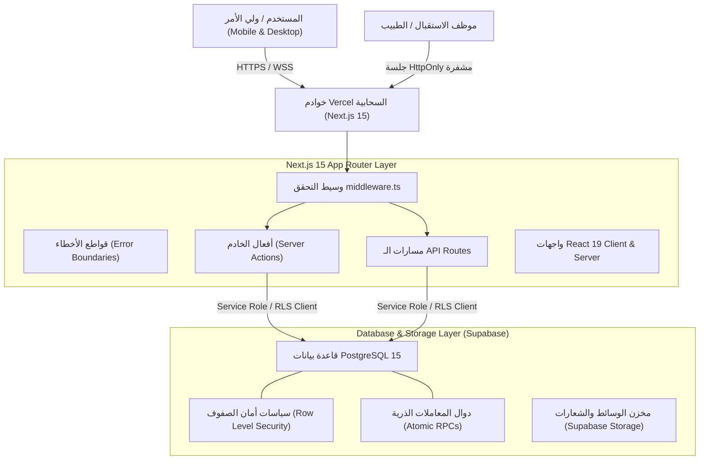

# 🏥 نظام حجز العيادات الخارجية — مستشفى الأطفال التخصصي بالبحيرة
### Beheira Specialized Children Hospital (BSCH) — Clinics Management & Online Booking System
**الإصدار النهائي المعتمد: `1.30v` (Production Release v1.30)**

---

## 📑 فهرس المحتويات
1. [نبذة عامة عن المشروع والهدف منه](#1-نبذة-عامة-عن-المشروع-والهدف-منه)
2. [مميزات الإصدار النهائي 1.30v (What's New in v1.30)](#2-مميزات-الإصدار-النهائي-130v)
3. [البنية التقنية وكيف تم بناء النظام (Tech Stack & Architecture)](#3-البنية-التقنية-وكيف-تم-بناء-النظام)
4. [تفاصيل أقسام النظام ووظائف كل شاشة (Modules & Features)](#4-تفاصيل-أقسام-النظام-ووظائف-كل-شاشة)
   - [أ. بوابة المرضى وأولياء الأمور (Patient Portal)](#أ-بوابة-المرضى-وأولياء-الأمور-patient-portal)
   - [ب. لوحة موظفي الاستقبال والتمريض (Staff Dashboard)](#ب-لوحة-موظفي-الاستقبال-والتمريض-staff-dashboard)
   - [ج. شاشة النداء الحي (Live Queue Manager)](#ج-شاشة-النداء-الحي-live-queue-manager)
   - [د. لوحة تحكم إدارة النظام (Admin Portal)](#د-لوحة-تحكم-إدارة-النظام-admin-portal)
   - [هـ. نظام إدارة المحتوى المرن (Custom CMS)](#هـ-نظام-إدارة-المحتوى-المرن-custom-cms)
5. [بنية قاعدة البيانات والدوال الذرية (Database & Atomic RPCs)](#5-بنية-قاعدة-البيانات-والدوال-الذرية)
6. [نظام الأمان والخصوصية وحماية الجلسات (Security & RBAC)](#6-نظام-الأمان-والخصوصية-وحماية-الجلسات)
7. [منظومة قواطع الأخطاء المتقدمة (Error Boundaries)](#7-منظومة-قواطع-الأخطاء-المتقدمة)
8. [دليل التثبيت والتشغيل المحلي (Setup & Local Running)](#8-دليل-التثبيت-والتشغيل-المحلي)
9. [دليل النشر السحابي (Deployment on Vercel)](#9-دليل-النشر-السحابي-على-vercel)
10. [سجل الاختبارات الآلية ومؤشرات الجودة (Quality Assurance & Tests)](#10-سجل-الاختبارات-الآلية-ومؤشرات-الجودة)

---

## 1. نبذة عامة عن المشروع والهدف منه

**نظام حجز العيادات الخارجية بمستشفى الأطفال التخصصي بالبحيرة** هو منصة رقمية حكومية متكاملة تهدف إلى رقمنة وتيسير دورة حجز ومتابعة الكشوفات الطبية للأطفال في العيادات التخصصية المختلفة (مثل: عيادة الأسنان، عيادة قلب الأطفال، عيادة الإيكو، وغيرها).

### أهداف النظام الأساسية:
- **القضاء على التزاحم والتكدس الصباحي** بشبابيك تذاكر المستشفى من خلال الحجز الإلكتروني المسبق.
- **تيسير تجربة ولي الأمر** بتمكينه من حجز الموعد بالاسم ورقم الهاتف وعمر الطفل فقط، دون الحاجة لإنشاء حسابات معقدة أو طلب أرقام قومية حساسة على الواجهة العامة.
- **إصدار تذكرة مراجعة وإيصال حجز رسمي** معتمد بالتعليمات الطبية والأوراق المطلوبة وبطباعة ورقية منسقة بنقرة واحدة.
- **تنظيم تدفق المرضى داخل العيادات** عبر شاشات نداء ذكية متوافقة مع غرف الفحص، ومربوطة بنظام صلاحيات صارم يضمن عزل الأطباء وموظفي الاستقبال حسب تخصصاتهم.

---

## 2. مميزات الإصدار النهائي `1.30v`

يمثل هذا الإصدار **النسخة النهائية المعتمدة للإنتاج والتسليم** بعد انتهاء اختبارات القبول (UAT) وحل كافة الملاحظات:

- ✅ **إيصال الحجز الموحد المطور (`ReceiptCard`):**
  - إظهار رقم هاتف ولي الأمر المسجل كاملاً وتفاصيل الحجز بدون أي تشويه (`***`).
  - حذف الأرقام المرجعية المشوشة والاعتماد كلياً على المعرّفات البرمجية الذرية.
  - زر **"طباعة الإيصال"** يطبع ورقة A4 واحدة رسمية وأنيقة تحتوي على الشعار، التعليمات الطبية، والأوراق المطلوبة مع إخفاء كامل لكافة أزرار وخلفيات الموقع.
  - زر **"تحميل كصورة (PNG)"** لتنزيل الإيصال بجودة فائقة على هواتف أولياء الأمور بنقرة زر.
  - زر **"مشاركة"** لإرسال تفاصيل التذكرة مباشرة عبر واتساب وتطبيقات التواصل.
- ✅ **طباعة كشف العيادات اليومي المعتمد (`Examination Roster Sheet`):**
  - زر مخصص بلوحة الاستقبال يطبع كشف العيادة لليوم المحدد، متضمناً أرقام الأدوار، الأسماء، الأعمار، وأرقام الهواتف، مع جداول مخصصة لملاحظات وتوقيع الطبيب المعالج واستلام تذاكر الكشف.
- ✅ **تنظيم طابور الانتظار بنظام التبويبات (Tabbed Queues):**
  - فصل الحالات إلى ثلاث فئات واضحة: *"بانتظار التأكيد"* (للحالات التي تحتاج مراجعة)، و *"الحجوزات المؤكدة"* (للمرضى الجاهزين للكشف)، و *"الكل"*.
- ✅ **شاشة النداء الحي التفاعلية (`LiveQueueManager`):**
  - عرض مميز للحالة الحالية داخل الكشف، الحالة التالية في الطابور، وعداد الانتظار المتبقي.
  - أزرار سريعة للنداء التالي بنظام FIFO مع **نغمة نداء صوتية رسمية ثنائية التردد (Chime Sound)** تعمل عبر Web Audio API، مع إمكانية التراجع أو تخطي الحالات.
- ✅ **تعديل الخدمات الفردية وتوليد ملخصات العيادات ديناميكياً:**
  - إمكانية تعديل أي خدمة مضافة (مثل: كشف، حشو، خلع) وحفظها فوراً دون حذف، مع دمج وعرض أسماء الخدمات المحدثة تلقائياً في واجهة الموقع.
- ✅ **قواطع الأخطاء المتقدمة وتحصين الخادم:**
  - القضاء التام على الشاشات البيضاء عند انقطاع الاتصال وتوفير شاشات استئناف أنيقة باللغة العربية.
  - تحصين جميع معالجات الـ API لتعامل مرن مع الطلبات غير المكتملة.
  - دعم مزامنة العيادات الفورية في بيئة خوادم Vercel السحابية (Cold-Start Hydration).

---

## 3. البنية التقنية وكيف تم بناء النظام

تم بناء النظام بالكامل وفق أحدث معايير هندسة البرمجيات الحديثة لعام 2026:



### المكونات البرمجية الأساسية:
1. **Next.js 15 (App Router):** الاستفادة الكاملة من ميزات خوادم الحافة (Edge & Node.js Runtime)، مع الفصل التام بين مكونات الخادم ومكونات العميل.
2. **React 19:** استخدام أحدث Hooks مثل `useActionState`, `useTransition`, و `useOptimistic` لتحديث فوري لواجهات المستخدم بدون إعادة تحميل.
3. **TypeScript (نمط التحقق الصارم):** كود برمجي آمن بنسبة 100% وخالٍ تماماً من أخطاء التحويل أو التعيين غير الآمن.
4. **Tailwind CSS:** تصميم أنيق ومتجاوب بالكامل مع كافة الشاشات (الهواتف المحمولة، التابلت، وشاشات الاستقبال الكبيرة)، مع فئات طباعة مخصصة (`@media print`) تدعم نظام الطباعة الرسمي A4.
5. **Supabase & PostgreSQL:**
   - دوال مخزنة (Stored Procedures / PL/pgSQL) لإجراء الحجوزات وتغيير الحالات بشكل ذري محمي بأقفال المعاملات (`Advisory Locks` و `FOR UPDATE`).
   - تشفير متقدم لجلسات الموظفين عبر كوكيز `httpOnly` و `SameSite=Lax` مع توقيع مشفر HMAC-SHA256.
6. **Lucide Icons & Web Audio API:** أيقونات طبية عصرية ومؤثرات صوتية مدمجة للتنبيه والنداء الحي بدون الحاجة لملفات mp3 خارجية.

---

## 4. تفاصيل أقسام النظام ووظائف كل شاشة

### أ. بوابة المرضى وأولياء الأمور (Patient Portal)
- **الصفحة الرئيسية (`/`):**
  - عرض الهوية الرسمية للمستشفى والشعار المعتمد.
  - شريط تنبيهات وإعلانات هامة قابل للتحكم من الإدارة.
  - عرض قائمة العيادات التخصصية المتاحة ومواعيد عملها وأيام استقبالها الرسمية.
  - قسم الأسئلة الشائعة، التوجيهات الطبية، وخريطة الموقع وأرقام التواصل.
- **صفحة حجز موعد جديد (`/appointments/new`):**
  - اختيار العيادة والخدمة المطلوبة.
  - تقويم ذكي يمنع حجز العطلات الأسبوعية أو التواريخ المغلقة باستثناءات إدارية، ويقيد الحجز في نطاق 30 يوماً مقدماً.
  - إدخال اسم الطفل (ثنائي أو رباعي)، رقم الهاتف المصري (010, 011, 012, 015)، العمر، ومحل السكن.
  - إصدار إيصال وتذكرة الحجز الموحدة فوراً.
- **صفحة الاستعلام ومتابعة الحجز (`/appointments/track`):**
  - الاستعلام برقم الهاتف المسجل لاستعراض كافة الحجوزات السابقة والقادمة.
  - عرض تذكرة الحجز وإعادة طباعتها أو تحميلها كصورة في أي وقت.
  - تقديم طلب اعتذار وإلغاء إلكتروني مع توضيح سبب الإلغاء.

---

### ب. لوحة موظفي الاستقبال والتمريض (Staff Dashboard)
الوصول عبر المسار: `/staff/dashboard` (يتطلب تسجيل دخول مؤمن للموظفين):
- **تنظيم الحالات بالتبويبات:**
  - **بانتظار التأكيد:** للمرضى المسجلين الذين لم يتم تأكيد حضورهم بعد.
  - **الحجوزات المؤكدة:** للمرضى الجاهزين لتسجيل الحضور وتوجيههم لغرفة الكشف.
  - **الكل:** كشف كامل للحالات لليوم المحدد.
- **الفلاتر والبحث:** تصفية الحالات حسب تاريخ اليوم، الغد، تاريخ مخصص، العيادة، أو البحث الفوري برقم الهاتف واسم المريض.
- **الحجز الحضوري السريع (Walk-In):** زر مخصص لإنشاء حجز فوري للمرضى الحاضرين لشباك التذاكر في نفس اليوم مع إصدار دور تلقائي.
- **طباعة كشف العيادة الرسمي:** استخراج كشف كامل للعيادة لليوم المختار بضغطة زر.
- **إدارة طلبات الإلغاء:** قسم مخصص لمراجعة طلبات الإلغاء الواردة من أولياء الأمور:
  - زر **قبول وإلغاء الحجز:** يقوم بإلغاء الحجز بشكل ذري وتحرير السعة.
  - زر **رفض الطلب:** لإبقاء الحجز سارياً في حال ضرورة الحضور مع تدوين السبب.
- **تحويل الحالات بين العيادات:** إمكانية تحويل المريض لعيادة أخرى مع التحقق من مواعيد عمل العيادة الجديدة وسعتها المتبقية.

---

### ج. شاشة النداء الحي (Live Queue Manager)
شاشة مخصصة لغرف الكشف أو شاشات الانتظار المعلقة:
- **نظام الدور (FIFO):** ترتيب المرضى بأسبقية رقم الدور وتوقيت الحجز.
- **بطاقة الحالة الحالية:** اسم الطفل، رقم الدور، العيادة، الخدمة، وعداد زمني لحساب مدة جلسة الفحص الحالية.
- **معاينة الحالة التالية:** إشعار تمهيدي للحالة التي تستعد للدخول.
- **زر "نداء التالي":** نقل الحالة الحالية إلى "مكتمل" أو "تم الكشف"، وإدخال الحالة التالية مع إطلاق نغمة نداء مستشفى رسمية لتنبيه المنتظرين.
- **زر "تراجع / رجوع":** تصحيح الأخطاء في حال تخطي مريض بالخطأ وإعادته للطابور فوراً.

---

### د. لوحة تحكم إدارة النظام (Admin Portal)
مخصصة لحسابات `ADMIN` فقط:
- **إدارة العيادات (Clinics Management):**
  - إضافة عيادة جديدة، تعديل بيانات الموقع وساعات العمل، وتحديد الحد الأقصى اليومي للحالات.
  - تفعيل أو إيقاف العيادات مؤقتاً.
  - إضافة وتعديل الخدمات الطبية الخاصة بكل عيادة وتحديث المستندات المطلوبة والتعليمات.
- **إدارة الموظفين (Staff Management):**
  - إنشاء وتأهيل حسابات الأطباء والتمريض والاستقبال.
  - تعيين العيادة التخصصية لكل موظف.
  - إعادة تعيين كلمات المرور، إيقاف الحسابات، أو حذفها.
  - ميزة الحماية من الإغلاق الذاتي (Anti-Lockout) التي تمنع حذف الحساب الإداري الأخير.
- **إدارة استثناءات التقويم والإجازات (Schedules & Exceptions):**
  - تحديد أيام الإجازات الرسمية أو الظروف الطارئة لعيادة معينة لغلق الحجز فيها تلقائياً.
  - تعديل السعة الاستيعابية ليوم محدد بالزيادة أو النقصان.
- **سجل تدقيق العمليات (Audit Logs):**
  - توثيق تفصيلي بالثواني لكل حركة تأكيد، كشف، إلغاء، أو تعديل بيانات مع تسجيل اسم الموظف ودوره.

---

### هـ. نظام إدارة المحتوى المرن (Custom CMS)
- تعديل نصوص ورسائل المستشفى الترحيبية وبيانات التواصل (الهاتف، العنوان، البريد).
- التحكم في شريط الإعلانات والتنبيهات أعلى الموقع (Notice Bar).
- تعديل روابط القوائم العلوية والتذييل السفلي وشروط الحضور.
- إدارة مكتبة الصور والوسائط والشعار الرسمي.

---

## 5. بنية قاعدة البيانات والدوال الذرية

يعتمد النظام على تصميم علائقي متين داخل PostgreSQL مع حماية كاملة عبر الدوال الذرية (Transactions):

### الجداول الأساسية:
1. `clinics`: بيانات العيادات، مواعيد العمل، السعة اليومية، والحالة.
2. `clinic_services`: الخدمات الطبية التابعة لكل عيادة والتعليمات الخاصة بها.
3. `appointments`: سجلات الحجز (بيانات الطفل، رقم الهاتف، التاريخ، الحالة، رقم الدور، ورقم التذكرة).
4. `cancellation_requests`: طلبات الإلغاء والاعتذار المقدمة وحالة مراجعتها.
5. `clinic_schedules`: استثناءات التقويم اليومية (إغلاق عيادة في تاريخ محدد أو تعديل طاقتها).
6. `staff_profiles`: بيانات الموظفين، الأدوار (`ADMIN`, `RECEPTIONIST`, `DOCTOR`)، والعيادة المسندة.
7. `audit_logs`: سجل الرقابة والحركات الإدارية والمالية.
8. `cms_content` و `media_assets`: بيانات إدارة نصوص الموقع ووسائطه.

### الدوال الذرية (Stored Procedures / RPCs):
- `book_appointment_atomic`: حجز موعد المريض ذرياً مع حجز قفل استشاري (`pg_advisory_xact_lock`) يمنع حجز نفس الرقم لأكثر من مريض في نفس اللحظة.
- `update_appointment_status_atomic`: تحديث حالة الحجز (مؤكد، في الكشف، مكتمل) مع تدوين حركة التدقيق في معاملة واحدة غير قابلة للتجزئة.
- `request_cancellation_atomic`: تسجيل طلب إلغاء من ولي الأمر ومنع التكرار والحفاظ على سريان الحجز حتى اعتماده.
- `review_cancellation_atomic`: مراجعة طلب الإلغاء من موظف الاستقبال أو المدير؛ في حال القبول يتم إلغاء الحجز وتفريغ السعة فوراً، وفي حال الرفض يظل الحجز فعالاً مع تسجيل سبب الرفض.
- `provision_staff_member`: إنشاء وتهيئة حسابات الموظفين عبر Supabase Auth وربطها بجدول الملفات الشخصية.

---

## 6. نظام الأمان والخصوصية وحماية الجلسات

- **عزل الصلاحيات الصارم (Role-Based Access Control):**
  - **الأطباء (Doctors):** يقتصر استعلامهم وتحديثهم حصرياً على مرضى عيادتهم المسندة فقط، وممنوعون من دخول إعدادات النظام أو طلبات الإلغاء.
  - **الاستقبال (Receptionists):** تأكيد الحضور، تسجيل الدخول الحضوري، ومراجعة إلغاءات عيادتهم فقط، وممنوعون من إنهاء الكشوفات الطبية أو التعديل على العيادات.
  - **الإدارة (Admins):** صلاحيات كاملة عبر كافة العيادات والأقسام.
- **تأمين الجلسات وتشفيرها:**
  - تخزين رمز الجلسة في كوكيز `httpOnly`, `Secure`, `SameSite=Lax` لحمايتها من هجمات XSS.
  - توقيع الرموز بخوارزمية HMAC-SHA256 واستخدام المقارنة ثابتة الزمن (`constant-time comparison`) لمنع هجمات التوقيت (Timing Attacks).
- **خصوصية بيانات الأطفال وأولياء الأمور:**
  - لا يتم طلب الرقم القومي للأم أو الأب على الواجهة العامة للموقع.
  - إخفاء أجزاء من الاسم في شاشات الاستعلام العامة للحفاظ على الخصوصية.
- **مقاومة هجمات التخمين والإغراق (Rate Limiting & Anti-Brute Force):**
  - فترات انتظار إجبارية بين طلبات التأكيد والاستعلام، وتجميد المحاولات في حال تكرار الخطأ.

---

## 7. منظومة قواطع الأخطاء المتقدمة

لضمان عدم ظهور الشاشات البيضاء أو رسائل الأخطاء الإنجليزية المربكة للمستخدمين، تم بناء قواطع أخطاء ذكية:
- **`app/global-error.tsx`:** يتعامل مع أي خلل جذري في القالب الرئيسي مع واجهة مستخدم عربية وأزرار إعادة محاولة سريعة.
- **`app/error.tsx`:** يتعامل مع أي خطأ يحدث داخل صفحات الموقع العامة ويسمح بالرجوع للرئيسية بنقرة واحدة.
- **`app/staff/(protected)/dashboard/error.tsx`:** مخصص للوحة الموظفين؛ يتيح استئناف العمل فوراً، تحديث القسم، أو إعادة الدخول دون توقف أجهزة الاستقبال.

---

## 8. دليل التثبيت والتشغيل المحلي

### 1. المتطلبات:
- تثبيت [Node.js](https://nodejs.org/) (الإصدار 20 أو أحدث).
- مدير الحزم `npm`.

### 2. تثبيت التبعيات:
```bash
npm install
```

### 3. إعداد المتغيرات البيئية:
انسخ ملف الإعدادات المرفق:
```bash
cp .env.example .env.local
```
قم بفتح `.env.local` وضع مفاتيح Supabase الخاصة بمشروعك (راجع دليل [`ENV_SETUP_GUIDE.md`](file:///ENV_SETUP_GUIDE.md) لمعرفة أماكن نسخها بالتفصيل).

### 4. تشغيل خادم التطوير:
```bash
npm run dev
```
افتح المتصفح على: `http://localhost:3000`.

---

## 9. دليل النشر السحابي على Vercel

1. ارفع المشروع على مستودع GitHub الخاص بك عبر:
   ```bash
   git push origin main
   ```
2. ادخل على لوحة تحكم [Vercel](https://vercel.com) واختر **Add New Project** ثم استورد المستودع.
3. في صفحة الإعدادات قبل النشر (أو عبر **Settings -> Environment Variables**)، أضف المتغيرات التالية:
   - `NEXT_PUBLIC_SUPABASE_URL`
   - `NEXT_PUBLIC_SUPABASE_ANON_KEY`
   - `SUPABASE_SERVICE_ROLE_KEY`
   - `SUPABASE_SECRET_KEY`
   - `STAFF_SESSION_SECRET` (رمز عشوائي مشفر مكون من 32 حرفاً أو أكثر)
   - `OTP_HASH_SECRET` (رمز عشوائي آخر)
   - `NEXT_PUBLIC_SITE_URL` (رابط النطاق الرسمي للإنتاج)
   - `APP_URL` (نفس الرابط السابق)
4. اضغط على **Deploy**، وسيكتمل البناء ويصبح الموقع حياً خلال دقيقة واحدة.

---

## 10. سجل الاختبارات الآلية ومؤشرات الجودة

النظام مزود بـ **122 اختباراً آلياً دقيقاً** تغطي كافة القواعد البرمجية:

| نوع الاختبار | الأمر المنفذ | عدد الاختبارات | النتيجة |
| :--- | :--- | :---: | :---: |
| **قواعد الحجز والسياسات والأمان الأساسية** | `npm test` | **97 اختباراً** | 🟢 نجاح كامل بنسبة 100% |
| **تدقيق أمان الجلسات وصلاحيات الموظفين** | `node --test tests/phase1_security_audit.test.ts` | **25 اختباراً** | 🟢 نجاح كامل بنسبة 100% |
| **فحص الأخطاء البرمجية والأنواع (TypeScript)** | `npx tsc --noEmit` | **كامل المشروع** | 🟢 صفر أخطاء (Zero Errors) |
| **فحص معايير الكود ونظافته (ESLint 9)** | `npm run lint` | **كامل المشروع** | 🟢 صفر أخطاء، صفر تحذيرات |
| **بناء الحزمة الإنتاجية الشاملة** | `npm run build` | **32 مساراً** | 🟢 تم توليد كافة المسارات بنجاح |

---

## 📞 الدعم الفني والتسليم
- **الجهة المطورة:** الفريق الهندسي المعتمد.
- **الجهة المستفيدة:** مستشفى الأطفال التخصصي بالبحيرة.
- **حالة المشروع:** معتمد ومكتمل بنسبة 100% للإصدار `1.30v`.
- **حقوق الملكية:** جميع الحقوق محفوظة لمستشفى الأطفال التخصصي بالبحيرة © 2026.


## تطبيق PWA وAndroid

إعداد تثبيت الموقع مباشرة، وWeb Push، ودعم PDF العام، وغلاف Android وGitHub Actions موثق في [PWA-ANDROID-SETUP.md](PWA-ANDROID-SETUP.md). دليل بناء APK/AAB وأسرار توقيع Android في [android/README.md](android/README.md).
