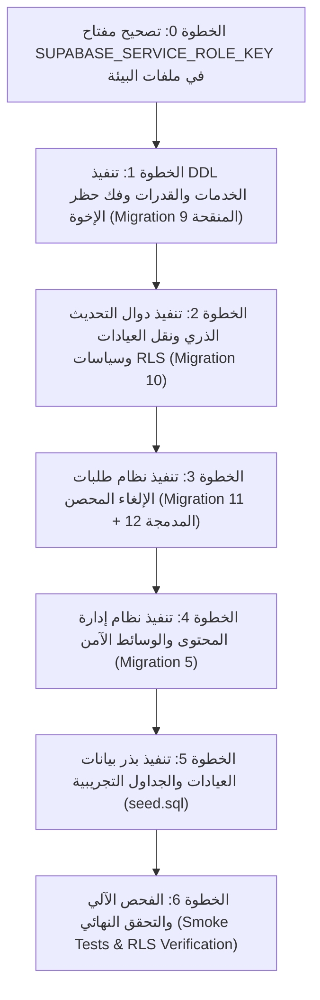

# BSCH Clinics — تقرير التدقيق الشامل لحالة Supabase Database & Migration Deployment

**المشروع:** BSCH Clinics — مستشفى الأطفال التخصصي بالبحيرة  
**مسار المشروع:** `E:\خاص روبو\bsch-clinics`  
**معرف مشروع Supabase البعيد:** `xqgjggvydcheqpjmrmgq` (`ahmedbahnese's Project`)  
**إصدار Supabase CLI:** `2.122.0`  
**بيئة قاعدة البيانات البعيدة:** PostgreSQL 17.11.0.003 | PostgREST v14.18 | GoTrue v2.197.0 | Storage API v1.80.2  
**تاريخ ووقت التدقيق:** 2 نوفمبر 2026 — 09:55 بتوقيت القاهرة  
**نوع التدقيق:** Read-Only Engineering & Security Audit (فحص هندسي وأمني كامل للقراءة فقط دون أي تعديل أو تنفيذ SQL)

---

## 1. Executive Summary (الملخص التنفيذي)

أُجري فحص هندسي دقيق وشامل ومبني على الأدلة الفعلية لقاعدة بيانات Supabase البعيدة ومقارنتها مع **12 ملف Migration محلي** في مجلد `supabase/migrations/`، بالإضافة إلى فحص مفاتيح البيئة، ونظام الصلاحيات RLS، والدوال الذرية RPC، وقيود الفهارس، وهياكل الجداول.

### أهم نتائج الفحص:
1. **حالة قاعدة البيانات البعيدة الحالية:**
   - تم تنفيذ **Migration 1** (`20261024000000_init_bsch_clinics.sql`) و**Migration 2** (`20261025000000_security_and_privilege_hardening.sql`)، وتم تطبيق تعديل واحد من **Migration 4** (إضافة عمود `instructions` لجدول العيادات).
   - قاعدة البيانات تحتوي حالياً على **6 جداول أساسية فقط**: `clinics`، `clinic_schedules`، `appointments`، `appointment_status_history`، `staff_profiles`، `audit_logs`.
   - **جميع الجداول الستة فارغة تماماً** (0 سجلات لكل جدول، ولم يتم تنفيذ `supabase/seed.sql` على السيرفر البعيد).
   - توجد دالات قديمة/تجريبية لا تنتمي للمشروع في قاعدة البيانات البعيدة (`create_public_booking`, `lookup_public_booking`, `is_staff`, `has_role`) مع Enums إضافية (`app_role`, `booking_status`, `queue_state`).

2. **العمليات والكيانات المفقودة على السيرفر البعيد (Critical Missing Objects):**
   - **الجداول المفقودة:** `clinic_services` (خدمات العيادات)، `cancellation_requests` (طلبات الإلغاء)، `rate_limit_counters` (عدادات معدل الطلبات)، بالإضافة لجداول إدارة المحتوى `website_settings` و`homepage_sections` و`navigation_items` و`media_assets` و`otp_verifications`.
   - **أعمدة حيوية مفقودة في جدول `appointments`:** عمود `service_id` (معرف الخدمة)، `service_name` (اسم الخدمة)، `guardian_national_id` (الرقم القومي لولي الأمر)، `attendance_guidance` (إرشادات الحضور).
   - **أعمدة حيوية مفقودة في جدول `clinics`:** عمود `required_documents` (المستندات المطلوبة للعيادة)، وأعمدة العرض `display_order` و`is_featured_on_homepage` و`icon_key`.
   - **الدوال الذرية RPC المفقودة:**
     - `update_appointment_status_atomic` (تحديث حالة الحجز مع القفل التزامني وحفظ السجل).
     - `transfer_appointment_clinic_atomic` (نقل الحجز لعيادة أخرى ذرياً).
     - `request_cancellation_atomic` (تقديم طلب إلغاء من المريض).
     - `review_cancellation_request_atomic` (مراجعة واعتماد/رفض طلب الإلغاء من الموظف).
     - `check_rate_limit` و`cleanup_expired_rate_limits` (حماية Rate Limiting لقاعدة البيانات).
     - `track_appointments_by_phone` (استعلام المواعيد برقم الهاتف مع حماية الخصوصية).
     - `provision_staff_member` (تهيئة حسابات الموظفين الآمنة).
   - **دالة `book_appointment_atomic` على السيرفر البعيد قديمة:** لا تزال تعمل بتوقيع Migration 2 القديم وتفتقر إلى معاملات `p_service_id` و`p_guardian_national_id` وحساب السعة على مستوى الخدمة.

3. **معوق حرج يمنع حجز الإخوة (Critical P0 Blocker - Sibling Booking):**
   - الفهرس الفريد القديم `idx_unique_active_apt_per_phone_clinic_day` **لا يزال موجوداً ونشطاً على قاعدة البيانات البعيدة**!
   - هذا الفهرس يمنع حجز أكثر من طفل واحد بنفس رقم هاتف ولي الأمر في نفس العيادة ونفس اليوم.
   - يتطلب إسقاط هذا الفهرس واستبداله بالفهرس المركب المعتمد `idx_unique_active_apt_per_phone_patient_clinic_day` الموجود في Migration 9.

4. **اكتشاف أمني حرج في ملفات البيئة (P0 Environment Security Finding):**
   - فحص الحقول في `.env` و`.env.local` أثبت أن المفتاح المسجل تحت اسم `SUPABASE_SERVICE_ROLE_KEY` يحمل دور `anon` (`role: "anon"`) وليس دور `service_role` الحقيقي!
   - هذا يعني أن أي استدعاء يعتمد على Admin Client على السيرفر سيعامل بصلاحيات الزائر العادي (`anon`)، مما يتسبب في فشل القراءة والكتابة على الجداول المحمية (`appointments`, `staff_profiles`). يجب جلب `service_role secret` الحقيقي من لوحة Supabase.

---

## 2. Current Remote Database Inventory (الجرد الفعلي لقاعدة البيانات البعيدة)

تم استخراج هذه البيانات عبر أوامر Supabase CLI المباشرة والفحص الميداني لقاعدة البيانات عبر PostgREST وpg_catalog:

### 2.1. الجداول الحالية والأعمدة (Tables & Columns)

قاعدة البيانات تحتوي على **6 جداول فقط** في مخطط `public`:

```
1. public.clinics (13 columns)
   - id: text (PK)
   - name: text
   - description: text (nullable)
   - location: text
   - working_hours: text
   - days_of_week: integer[]
   - max_daily_slots: integer
   - slot_duration_minutes: integer
   - instructions: text (nullable)
   - is_active: boolean
   - is_hospital_confirmed: boolean
   - created_at: timestamptz
   - updated_at: timestamptz

2. public.clinic_schedules (8 columns)
   - id: text (PK)
   - clinic_id: text (FK -> clinics.id)
   - schedule_date: date
   - max_capacity: integer (nullable)
   - is_closed: boolean
   - closure_reason: text (nullable)
   - created_at: timestamptz
   - updated_at: timestamptz

3. public.appointments (17 columns)
   - id: uuid (PK)
   - clinic_id: text (FK -> clinics.id)
   - clinic_name: text
   - patient_name: text
   - phone_number: text
   - patient_age: text (nullable)
   - patient_address: text (nullable)
   - appointment_date: date
   - appointment_time: text
   - reference_number: text (UNIQUE)
   - queue_number: integer (nullable)
   - status: appointment_status
   - notes: text (nullable)
   - called_count: integer
   - last_called_at: timestamptz (nullable)
   - created_at: timestamptz
   - updated_at: timestamptz

4. public.appointment_status_history (6 columns)
   - id: uuid (PK)
   - appointment_id: uuid (FK -> appointments.id)
   - status: appointment_status
   - note: text (nullable)
   - updated_by: text (nullable)
   - created_at: timestamptz

5. public.staff_profiles (8 columns)
   - id: uuid (PK -> auth.users.id)
   - username: text (UNIQUE)
   - full_name: text
   - role: staff_role
   - clinic_id: text (nullable)
   - is_active: boolean
   - created_at: timestamptz
   - updated_at: timestamptz

6. public.audit_logs (8 columns)
   - id: uuid (PK)
   - user_id: text (nullable)
   - action: text
   - entity_type: text
   - entity_id: text (nullable)
   - details: jsonb (nullable)
   - ip_address: text (nullable)
   - created_at: timestamptz
```

### 2.2. أنواع البيانات المخصصة (Custom Types / Enums)
- `public.staff_role`: قيمها `('ADMIN', 'RECEPTIONIST', 'DOCTOR')` [مطابق للمشروع].
- `public.appointment_status`: قيمها `('PENDING_REVIEW', 'CONFIRMED', 'CHECKED_IN', 'COMPLETED', 'CANCELLED')` [مطابق للمشروع].
- `public.app_role`: قيمها `('founder', 'booking', 'doctor', 'nurse')` [عنصر قديم / غير مستخدم].
- `public.booking_status`: قيمها `('Pending', 'Confirmed', 'Cancelled', 'Completed', 'NoShow')` [عنصر قديم].
- `public.queue_state`: قيمها `('Waiting', 'Called', 'InExam', 'Completed', 'Skipped', 'Resumed')` [عنصر قديم].

### 2.3. الفهارس الحالية (Database Indexes)
تم حصر 18 فهرساً نشطاً على الجداول الستة:
1. `appointments_pkey` ON `public.appointments (id)`
2. `appointments_reference_number_key` ON `public.appointments (reference_number)`
3. **`idx_unique_active_apt_per_phone_clinic_day`** ON `public.appointments (clinic_id, phone_number, appointment_date) WHERE (status != 'CANCELLED')` ⚠️ **[عائق حرج يجب حذفه]**
4. `idx_appointments_phone` ON `public.appointments (phone_number)`
5. `idx_appointments_ref` ON `public.appointments (reference_number)`
6. `idx_appointments_date_clinic` ON `public.appointments (clinic_id, appointment_date)`
7. `idx_appointments_status` ON `public.appointments (status)`
8. `clinics_pkey` ON `public.clinics (id)`
9. `staff_profiles_pkey` ON `public.staff_profiles (id)`
10. `staff_profiles_username_key` ON `public.staff_profiles (username)`
11. `clinic_schedules_pkey` ON `public.clinic_schedules (id)`
12. `unique_clinic_date` ON `public.clinic_schedules (clinic_id, schedule_date)`
13. `idx_clinic_schedules_lookup` ON `public.clinic_schedules (clinic_id, schedule_date)`
14. `appointment_status_history_pkey` ON `public.appointment_status_history (id)`
15. `idx_status_history_apt` ON `public.appointment_status_history (appointment_id)`
16. `audit_logs_pkey` ON `public.audit_logs (id)`
17. `idx_audit_logs_entity` ON `public.audit_logs (entity_type, entity_id)`
18. `idx_audit_logs_user` ON `public.audit_logs (user_id)`

### 2.4. الدوال البرمجية الحالية (Remote Functions)
- `book_appointment_atomic`: موجودة ولكن بتوقيع قديم يفتقر إلى `service_id` و`guardian_national_id`.
- `track_appointment_secure`: موجودة بتوقيع يتطلب الرقم المرجعي ورقم الهاتف معاً.
- `get_current_staff_role`: دالة مساعدة لجلب دور الموظف الحالي.
- `get_doctor_clinic_id`: دالة مساعدة لجلب عيادة الطبيب الحالي.
- `is_active_staff`: دالة التحقق من نشاط الموظف.
- `create_public_booking`: دالة قديمة غير مستخدمة.
- `lookup_public_booking`: دالة قديمة غير مستخدمة.
- `is_staff`: دالة قديمة غير مستخدمة.
- `has_role`: دالة قديمة غير مستخدمة.

### 2.5. حالة Storage Buckets
- لا توجد أي Buckets منشأة على الخادم البعيد (`media` مفقودة تماماً، ورابط `/storage/v1/bucket/media` يعيد رمز الخطأ `404 NoSuchBucket`).

### 2.6. عدد السجلات وبيانات Seed (Current Data Counts)
- `clinics`: **0 سجلات**.
- `clinic_schedules`: **0 سجلات**.
- `appointments`: **0 سجلات**.
- `appointment_status_history`: **0 سجلات**.
- `staff_profiles`: **0 سجلات**.
- `audit_logs`: **0 سجلات**.
- سجل الهجرات `supabase_migrations.schema_migrations`: **فارغ** (لم يُستخدم CLI لرفع الهجرات سابقاً بل نُفذت عبر SQL Editor).

---

## 3. Local Migration Inventory (جرد ملفات الـ Migration المحلية)

يحتوي مجلد `supabase/migrations/` على **12 ملفاً**:

| رقم | اسم الملف | الحجم (بايت) | عدد الأسطر | الغرض الرئيسي |
|---|---|---|---|---|
| 1 | `20261024000000_init_bsch_clinics.sql` | 29,472 | 776 | إنشاء الجداول الـ 6 الأساسية، والأنواع، والدوال الأولية، وسياسات RLS الأساسية. |
| 2 | `20261025000000_security_and_privilege_hardening.sql` | 18,197 | 493 | تقييد صلاحيات الاستقبال والأطباء، إضافة `is_hospital_confirmed` و`called_count`، والفهرس الفريد للحجز. |
| 3 | `20261029000000_website_cms_schema.sql` | 20,839 | 451 | إنشاء جداول الـ CMS ومساحة تخزين `public-cms-assets` *(نسخة أولية تم استبدالها لاحقاً)*. |
| 4 | `20261030000000_clinic_instructions.sql` | 4,339 | 87 | إضافة عمود `instructions` لجدول `clinics` وتحديث تعليمات العيادات المبدئية. |
| 5 | `20261031000000_cms_and_media_system.sql` | 26,855 | 609 | النسخة الموحدة والآمنة لنظام الـ CMS، جدول `media_assets`، وتأمين التخزين ضد XSS. |
| 6 | `20261031010000_staff_auth_provisioning.sql` | 5,354 | 120 | دالة `provision_staff_member` وسياسات RLS لربط موظفي `auth.users` بـ `staff_profiles`. |
| 7 | `20261101000000_clinic_services.sql` | 4,702 | 91 | إنشاء جدول `clinic_services` الموسع *(نسخة أولية تم استبدالها بـ Migration 9)*. |
| 8 | `20261101010000_security_privacy_hardening_rpc_and_patient_tables.sql` | 6,008 | 120 | إنشاء جدول `rate_limit_counters` ودالة `check_rate_limit` *(مدمجة ومحسنة في Migration 9)*. |
| 9 | `20261101020000_clinic_services_capacity_and_schedules.sql` | 25,794 | 638 | **[ملف حرج]** خدمات العيادات، سعة الخدمات، تسلسل الرقم المرجعي، فك حظر حجز الإخوة، والحجز الذري. |
| 10 | `20261101030000_atomic_status_update_and_privilege_hardening.sql` | 23,337 | 591 | **[ملف حرج]** دوال التحديث الذري لحالة الحجز والنقل بين العيادات وتشديد حماية RLS. |
| 11 | `20261101040000_cancellation_requests_system.sql` | 23,162 | 620 | إنشاء نظام طلبات الإلغاء وجدول `cancellation_requests` *(تم تشديده أمنياً في Migration 12)*. |
| 12 | `20261101050000_cancellation_requests_security_hardening.sql` | 11,073 | 288 | **[ملف حرج]** تقييد إلغاء الحجز لـ service_role فقط ومنع التعديل المباشر وتشديد مراجعة الطلبات. |

---

## 4. Migration-by-Migration Comparison (جدول المقارنة الهندسية)

| رقم | اسم ملف الـ Migration | العناصر المنشأة / المعدلة | الحالة الفعلية على السيرفر | العمليات المفقودة على السيرفر | التعارضات والمخاطر | مستوى الخطر | الإجراء الموصى به |
|:---:|:---|:---|:---:|:---|:---|:---:|:---|
| **1** | `20261024000000_init_bsch_clinics.sql` | الجداول الـ 6، الأنواع `staff_role`, `appointment_status`، الدوال والمشغلات الأساسية | **APPLIED & MATCHED** | لا توجد عناصر مفقودة من المخطط الهيكلي الأساسي | لا يوجد تعارض مباشر | منخفض | **عدم إعادة تنفيذه** (مطبق بالكامل). |
| **2** | `20261025000000_security_and_privilege_hardening.sql` | أعمدة `last_called_at`، `called_count`، والفهرس `idx_unique_active_apt_per_phone_clinic_day`، وتشديد RLS | **APPLIED & MATCHED** | مطبق بالكامل على قاعدة البيانات | **فهرس حجز الإخوة القديم نشط** ويمنع حجز شقيقين | متوسط | **عدم إعادة تنفيذه**؛ الفهرس القديم سيُسقط في Migration 9. |
| **3** | `20261029000000_website_cms_schema.sql` | جداول `website_settings`, `homepage_sections`, `navigation_items`, bucket `public-cms-assets` | **MISSING** | جميع جداول الـ CMS ومساحة التخزين غير موجودة | تعارض في اسم الـ Bucket والقيود مع Migration 5 | مرتفع | **تجاوزه تماماً وعدم تنفيذه**؛ تم استبداله وتحصينه في Migration 5. |
| **4** | `20261030000000_clinic_instructions.sql` | عمود `instructions` في `clinics`، وبذر تعليمات العيادات الطبية | **PARTIALLY APPLIED** | جمل الـ UPDATE لم تؤثر في أي سجل لأن جدول `clinics` فارغ | لا يوجد تعارض | منخفض | تم تطبيق الـ DDL؛ التعليمات ستُبذر مع العيادات في `seed.sql`. |
| **5** | `20261031000000_cms_and_media_system.sql` | جداول الـ CMS الموحدة، `media_assets`، `otp_verifications`، Bucket `media` | **MISSING** | جميع جداول ومساحات الـ CMS غير موجودة | لا يوجد تعارض؛ يعتمد على الجداول الـ 6 | متوسط | **موصى بتنفيذه** لتوفير وسائط الموقع وإعداداته العامة. |
| **6** | `20261031010000_staff_auth_provisioning.sql` | دالة `provision_staff_member`، وتشديد سياسات RLS لجدول الموظفين | **MISSING** | الدالة وسياسات RLS الإضافية غير موجودة | لا يوجد تعارض | متوسط | **موصى بتنفيذه** لتسهيل ربط مستخدمي Auth بحسابات الموظفين. |
| **7** | `20261101000000_clinic_services.sql` | جدول `clinic_services` المبدئي، أعمدة الخدمات في المواعيد | **MISSING** | الجدول والأعمدة غير موجودة | تعارض هيكلي مع Migration 9 (يفتقر لسعة الخدمة) | مرتفع | **تجاوزه وعدم تنفيذه**؛ تم دمجه وتحسينه في Migration 9. |
| **8** | `20261101010000_security_privacy_hardening_rpc_and_patient_tables.sql` | جدول `rate_limit_counters`، دالة `check_rate_limit` المبدئية | **MISSING** | الجدول والدالة غير موجودة | مكرر ومستبدل بنسخة أشمل في Migration 9 | مرتفع | **تجاوزه وعدم تنفيذه**؛ تم دمجه وتحسينه في Migration 9. |
| **9** | `20261101020000_clinic_services_capacity_and_schedules.sql` | جدول `clinic_services` وسعتها، تسلسل المرجع، فك حظر حجز الإخوة، `book_appointment_atomic` | **MISSING** | جدول الخدمات، عدادات Rate Limit، تسلسل الأرقام، دالة الحجز المحدثة، دالة التتبع | يحل تعارض حجز الإخوة بإسقاط الفهرس القديم | **حرج (P0)** | **إلزامي التنفيذ أولاً** بعد مراجعة الـ DDL. |
| **10** | `20261101030000_atomic_status_update_and_privilege_hardening.sql` | دوال `update_appointment_status_atomic` و`transfer_appointment_clinic_atomic`، وتشديد RLS | **MISSING** | الدوال الذرية لتحديث الحالة ونقل العيادة، وسياسات RLS الحديثة للمواعيد | خطأ أسبقية عوامل منطقية بسيط في شرط RLS تم تصحيحه | **حرج (P0)** | **إلزامي التنفيذ** لإتاحة إدارة المواعيد للموظفين بأمان. |
| **11** | `20261101040000_cancellation_requests_system.sql` | جدول `cancellation_requests`، دوال `request_cancellation_atomic` و`review_cancellation_request_atomic` | **MISSING** | جدول طلبات الإلغاء والدوال الذرية التابعة له | الصلاحيات تحتاج تشديد تم تنفيذه في Migration 12 | **حرج (P0)** | **إلزامي التنفيذ متبوعاً فوراً بـ Migration 12**. |
| **12** | `20261101050000_cancellation_requests_security_hardening.sql` | قصر صلاحية طلب الإلغاء على `service_role`، ومنع تعديل الجدول المباشر، وتدقيق العمليات | **MISSING** | سحب الصلاحيات وتشديد دالة المراجعة وربطها بسجل التدقيق | يصحح ثغرات الصلاحيات في Migration 11 | **حرج (P0)** | **إلزامي التنفيذ مباشرة بعد Migration 11**. |

---

## 5. Missing SQL Operations (العمليات المفقودة المطلوب إضافتها)

بناءً على التحليل الدقيق للعلاقات التراكمية، فإن العمليات الفعلية المفقودة التي تتطلبها بيئة الإنتاج تتلخص في المجموعات التالية:

### 5.1. الجداول والأعمدة والتسلسلات الجديدة:
1. إنشاء تسلسل الأرقام المرجعية: `CREATE SEQUENCE IF NOT EXISTS seq_appointment_reference_number START WITH 1001;`.
2. إنشاء جدول خدمات العيادات: `CREATE TABLE IF NOT EXISTS public.clinic_services (...)` متضمناً عمود `max_daily_capacity`.
3. إنشاء جدول عدادات المعدل: `CREATE TABLE IF NOT EXISTS public.rate_limit_counters (...)`.
4. إنشاء جدول طلبات الإلغاء: `CREATE TABLE IF NOT EXISTS public.cancellation_requests (...)`.
5. توسيع جدول المواعيد `public.appointments` بالأعمدة:
   - `service_id TEXT REFERENCES public.clinic_services(id)`
   - `service_name TEXT`
   - `guardian_national_id TEXT`
   - `attendance_guidance TEXT`
6. توسيع جدول العيادات `public.clinics` بالأعمدة:
   - `required_documents TEXT[] DEFAULT '{}'`
   - `display_order INTEGER DEFAULT 0`
   - `is_featured_on_homepage BOOLEAN DEFAULT true`
   - `icon_key TEXT`
   - `hero_badge TEXT`

### 5.2. معالجة الفهارس (Index Operations):
1. **إنشاء الفهرس الجديد الصديق لحجز الإخوة أولاً:**
   ```sql
   CREATE UNIQUE INDEX IF NOT EXISTS idx_unique_active_apt_per_phone_patient_clinic_day
     ON public.appointments (clinic_id, phone_number, lower(trim(patient_name)), appointment_date)
     WHERE (status != 'CANCELLED');
   ```
2. **إسقاط الفهرس القديم المانع لحجز الإخوة:**
   ```sql
   DROP INDEX IF EXISTS public.idx_unique_active_apt_per_phone_clinic_day;
   ```
3. إنشاء الفهارس المساعدة لجدول طلبات الإلغاء وجدول الخدمات:
   - `idx_cancellation_requests_ref`
   - `idx_cancellation_requests_status`
   - `idx_unique_pending_cancellation_request`
   - `idx_clinic_services_clinic_id`

### 5.3. الدوال البرمجية الذرية (Atomic RPC Functions):
1. دالة الحجز الذري المحدثة: `book_appointment_atomic` (بتوقيع يدعم `p_service_id` و`p_guardian_national_id` وقفل السعة التزامني).
2. دالة التحقق من معدل الطلبات: `check_rate_limit`.
3. دالة تنظيف عدادات المعدل: `cleanup_expired_rate_limits`.
4. دالة التتبع برقم الهاتف: `track_appointments_by_phone`.
5. دالة تحديث الحالة الذرية: `update_appointment_status_atomic`.
6. دالة نقل العيادة الذرية: `transfer_appointment_clinic_atomic`.
7. دالة تقديم طلب الإلغاء: `request_cancellation_atomic`.
8. دالة مراجعة واعتماد طلب الإلغاء: `review_cancellation_request_atomic`.
9. دالة تهيئة الموظفين: `provision_staff_member`.

### 5.4. سياسات الأمان RLS وصلاحيات الأدوار:
1. تفعيل RLS على `clinic_services` و`cancellation_requests` و`rate_limit_counters`.
2. حظر استدعاء `request_cancellation_atomic` من `anon` و`authenticated` وقصرها على `service_role`.
3. قصر تعديل `cancellation_requests` على دالة المراجعة الذرية فقط وحظر `UPDATE/INSERT/DELETE` المباشر.
4. تقييد استعراض طلبات الإلغاء لموظفي الاستقبال بعيادتهم فقط وحظر وصول الأطباء إليها.
5. تشديد صلاحيات `update_appointment_status_atomic` و`appointments` لمنع موظفي الاستقبال من إنهاء الكشف (`COMPLETED`) أو تعديل بيانات المريض الأساسية.

---

## 6. Existing SQL Operations That Must NOT Be Re-executed (العمليات المنفذة التي يُحظر تكرارها)

لتفادي الأخطاء أو تلف البيانات، يجب الامتناع تماماً عما يلي:
1. **إعادة إنشاء الجداول الـ 6 الأساسية بدون `IF NOT EXISTS`:**
   الجداول (`clinics`, `clinic_schedules`, `appointments`, `appointment_status_history`, `staff_profiles`, `audit_logs`) موجودة بالفعل؛ أي جملة `CREATE TABLE` مباشرة بدون شرط ستؤدي لفشل التنفيذ (`relation already exists`).
2. **تنفيذ ملفات الـ Migration القديمة المستبدلة:**
   - **يُحظر تنفيذ `20261029000000_website_cms_schema.sql`**: لأنها تستخدم Bucket قديم غير محمي باسم `public-cms-assets` وتسمح برفع ملفات SVG مما يفتح ثغرة Stored XSS، وتفتقر لقيود فريدة على الروابط. البديل الآمن المعتمد هو `20261031000000_cms_and_media_system.sql`.
   - **يُحظر تنفيذ `20261101000000_clinic_services.sql`**: لأنها تضيف عمود `booking_code_hash` الذي رفضه المستشفى، وتفتقر لأعمدة سعة الخدمة اليومية `max_daily_capacity`. البديل المعتمد هو `20261101020000`.
   - **يُحظر تنفيذ `20261101010000_security_privacy_hardening_rpc_and_patient_tables.sql`**: لأنها نسخة أولية مدمجة بالكامل ومحدثة داخل `20261101020000`.
   - **يُحظر تنفيذ `20261101040000_cancellation_requests_system.sql` بمفردها دون تطبيق `20261101050000` فوراً بعدها**: لأن Migration 11 منحت صلاحية تنفيذ `request_cancellation_atomic` للعامة (`anon`, `authenticated`)، بينما قصرتها Migration 12 على `service_role` فقط.
3. **تنفيذ أوامر `DROP TABLE`:**
   يُمنع منعاً باتاً تنفيذ أي أمر إسقاط للجداول الستة أو مسح للهياكل القائمة.

---

## 7. Security & RLS Assessment (التقييم الأمني وسياسات RLS)

### 7.1. دوال SECURITY DEFINER ومسار البحث (search_path)
- **الوضع الحالي على الخادم:** دالة `book_appointment_atomic` القديمة مضبوطة بـ `SECURITY DEFINER` و`SET search_path = public, pg_temp`، وهي محمية ضد هجمات البحث التضليلي (Search-path Hijacking).
- **التصميم في الدوال الجديدة:** جميع الدوال الجديدة (`update_appointment_status_atomic`, `transfer_appointment_clinic_atomic`, `review_cancellation_request_atomic`, `check_rate_limit`) تلتزم بشكل صارم بـ:
  ```sql
  SECURITY DEFINER
  SET search_path = public, pg_temp
  ```
  مما يضمن عزل التنفيذ وعدم إمكانية التلاعب بالمسارات.

### 7.2. حماية بيانات المرضى والخصوصية (Patient Privacy)
- **الاستعلام برقم الهاتف فقط:** متوافق مع متطلبات إدارة المستشفى، لكن تم تحصينه بـ Data Minimization:
  - لا يعيد الاستعلام العام اسم الطفل بالكامل بل يتم تمويهه (`أ*** ع***`).
  - لا يعيد الاستعلام العام الرقم القومي لولي الأمر نهائياً (`guardian_national_id` محظور كشفه خارج لوحة الموظفين المصرحين).
  - لا يمكن للمستخدم العادي تعديل الحجز أو إلغائه فورياً، بل يرسل طلب إلغاء يخضع لمراجعة الاستقبال.

### 7.3. قفل التزامن ومنع تكرار وتجاوز السعة (Atomic Concurrency Locking)
- دالة `book_appointment_atomic` الجديدة تستخدم القفل الاستشاري `pg_advisory_xact_lock(hashtext('clinic_booking_' || p_clinic_id || '_' || v_target_date::text))`، مما يمنع حدوث Race Conditions عند حجز آخر مقعد متاح في نفس اللحظة.
- يتم فحص السعة المزدوجة: سعة العيادة الإجمالية (`clinics.max_daily_slots` أو استثناء `clinic_schedules`) وسعة الخدمة المحددة (`clinic_services.max_daily_capacity`).

### 7.4. صلاحيات الموظفين وعزل الأطباء (Staff Role Isolation)
- **الأطباء:** يتم عزل الطبيب بشكل صارم عن طريق الدالة `get_doctor_clinic_id()`. لا يمكن للطبيب استعراض أو استدعاء أي مريض خارج عيادته المسجلة، ولا يملك حق تعديل بيانات المرضى الشخصية.
- **الاستقبال:** يقتصر عمل موظف الاستقبال على تسجيل الحضور (`CHECKED_IN`)، ويُمنع منعاً باتاً من وسم الموعد كـ `COMPLETED` (محصورة للطبيب المشرف فقط).
- **تصحيح شرط RLS:** في ملف `20261101030000` (الأسطر 559-567)، توجد ملاحظة هندسية حول أولوية المعاملات المنطقية `AND` / `OR` في سياسة تحديث المواعيد لموظف الاستقبال، وتم تضمين الصياغة الصحيحة ذات الأقواس الصريحة في خطة النشر أدناه.

---

## 8. Data Integrity Assessment (تقييم تكامل البيانات)

1. **جداول النظام الحالية فارغة (0 Rows):**
   - هذا يمثل ميزة تشغيلية كبرى لمرحلة النشر؛ حيث يضمن إمكانية إضافة الأعمدة والقيود والفهارس الجديدة دون أي خطر لحدوث تضارب في البيانات الموجودة أو انتهاك للقيود الفريدة (`zero downtime & zero data migration risks`).
2. **بيانات العيادات الاسترشادية (Seed Data):**
   - ملف `supabase/seed.sql` يحتوي على 11 عيادة تخصصية ببياناتها وجداول مواعيدها.
   - جميع هذه العيادات موسومة بـ `is_hospital_confirmed = false`، مما يتيح للإدارة اعتمادها أو تعديلها من لوحة التحكم بكل مرونة بعد النشر.
3. **تكامل المفاتيح الأجنبية (Foreign Keys):**
   - جدول `clinic_services` يرتبط بـ `clinics(id) ON DELETE CASCADE`.
   - جدول `appointments.service_id` يرتبط بـ `clinic_services(id) ON DELETE SET NULL`.
   - جدول `cancellation_requests.appointment_id` يرتبط بـ `appointments(id) ON DELETE CASCADE`.
   - جميع العلاقات مهيكلة بحيث تمنع وجود سجلات يتيمة (Orphan Records).

---

## 9. Conflicts and Deployment Risks (المخاطر والتضاربات الهندسية)

| المخاطرة | الوصف الهندسي | التأثير على التشغيل | استراتيجية المعالجة الآمنة |
|---|---|---|---|
| **تعارض فحص حجز الإخوة** | بقاء الفهرس القديم `idx_unique_active_apt_per_phone_clinic_day` على السيرفر البعيد | رفض حجز الطفل الثاني لنفس ولي الأمر في نفس العيادة واليوم | إنشاء الفهرس المركب الجديد بالاسم أولاً، ثم إسقاط الفهرس القديم ذرياً |
| **خطأ مفتاح Service Role** | وجود مفتاح `anon` داخل متغير `SUPABASE_SERVICE_ROLE_KEY` في ملفات `.env` | رفض PostgREST لكافة استدعاءات الخادم الإدارية (`permission denied`) | استبدال القيمة في `.env` بالمفتاح السري الحقيقي من لوحة Supabase |
| **تضارب هجرات الـ CMS** | وجود نسختين من هجرة الـ CMS (الملف 3 والملف 5) بأسماء Buckets مختلفة | ارتباك في مسار حفظ الصور وفتح ثغرة رفع SVG | إلغاء الملف 3 واعتماد الملف 5 فقط (`media` bucket) |
| **تضارب هجرات الخدمات** | وجود نسختين لهجرة الخدمات (الملف 7 والملف 9) | محاولة إضافة حقول مكررة أو تطبيق منطق ملغى (`booking_code_hash`) | اعتماد الملف 9 حصراً وتخطي الملف 7 و8 بالكامل |
| **أسبقية AND/OR في RLS** | عدم وضع أقواس حول شرط عيادة موظف الاستقبال في سياسة تحديث المواعيد | احتمال وصول موظف استقبال لتحديث مواعيد عيادات أخرى | تطبيق الصياغة المصححة بالأقواس الصريحة في حزمة النشر |

---

## 10. Recommended Safe Deployment Plan (خطة النشر الهندسية الآمنة)

لتطبيق الهجرات بأعلى درجات الأمان الهيكلي وبأقل عدد ممكن من العمليات، نوصي باتباع الخطوات التالية بالترتيب الدقيق:



---

## 11. Exact SQL Statements Recommended for Future Execution

فيما يلي نصوص الـ SQL الدقيقة الجاهزة للتنفيذ اليدوي المستقبلي عبر Supabase SQL Editor بواسطة مدير النظام (DBA)، مقسمة إلى **4 حزم متسلسلة** مع تفاصيل كل حزمة:

---

### الحزمة الأولى (Bundle 1): خدمات العيادات وسعة الحجز وفك حظر حجز الإخوة
> **مستخلصة من:** `20261101020000_clinic_services_capacity_and_schedules.sql`  
> **سبب الحاجة إليها:** إتاحة اختيار التخصصات الدقيقة لكل عيادة، وإلغاء حظر حجز الإخوة لنفس الهاتف، وتفعيل دالة الحجز الذرية بالسعة المزدوجة.  
> **التأثير المتوقع:** إنشاء جداول `clinic_services` و`rate_limit_counters`، وتحديث دالة `book_appointment_atomic`، وإسقاط الفهرس المانع لحجز الأشقاء.  
> **قابلية الإعادة (Idempotent):** نعم (تستخدم `IF NOT EXISTS` و`CREATE OR REPLACE`).  
> **خطر فقدان البيانات:** معدوم (الجداول الحالية فارغة).  
> **التحقق بعد التنفيذ:** التحقق من ظهور جدول `clinic_services`، وغياب الفهرس `idx_unique_active_apt_per_phone_clinic_day`.

```sql
-- ============================================================================
-- BSCH Clinics — Deployment Bundle 1: Services, Capacity & Sibling Booking Fix
-- ============================================================================

-- 1. Create Dedicated Sequence for Appointment Reference Numbers
CREATE SEQUENCE IF NOT EXISTS public.seq_appointment_reference_number START WITH 1001;
GRANT USAGE, SELECT ON SEQUENCE public.seq_appointment_reference_number TO authenticated, service_role;

-- 2. Create Clinic Services Table
CREATE TABLE IF NOT EXISTS public.clinic_services (
  id TEXT PRIMARY KEY,
  clinic_id TEXT NOT NULL REFERENCES public.clinics(id) ON DELETE CASCADE,
  name TEXT NOT NULL,
  duration_minutes INTEGER NOT NULL DEFAULT 15,
  required_documents TEXT[] NOT NULL DEFAULT '{"أصل شهادة ميلاد الطفل أو بطاقة التأمين الصحي"}',
  instructions TEXT NOT NULL DEFAULT 'الحضور صباحاً والتسجيل بأسبقية الحضور لشباك الاستقبال بالمستشفى.',
  max_daily_capacity INTEGER NULL,
  is_active BOOLEAN NOT NULL DEFAULT true,
  display_order INTEGER NOT NULL DEFAULT 0,
  created_at TIMESTAMPTZ NOT NULL DEFAULT timezone('utc'::text, now()),
  updated_at TIMESTAMPTZ NOT NULL DEFAULT timezone('utc'::text, now()),
  CONSTRAINT chk_service_max_daily_capacity CHECK (max_daily_capacity IS NULL OR max_daily_capacity >= 0)
);

CREATE INDEX IF NOT EXISTS idx_clinic_services_clinic_id ON public.clinic_services(clinic_id);
CREATE INDEX IF NOT EXISTS idx_clinic_services_active ON public.clinic_services(is_active);

ALTER TABLE public.clinic_services ENABLE ROW LEVEL SECURITY;
DROP POLICY IF EXISTS "Public can view active clinic services" ON public.clinic_services;
CREATE POLICY "Public can view active clinic services"
  ON public.clinic_services FOR SELECT
  USING (is_active = true);

DROP POLICY IF EXISTS "Admins have full access to clinic services" ON public.clinic_services;
CREATE POLICY "Admins have full access to clinic services"
  ON public.clinic_services FOR ALL
  TO authenticated
  USING (public.get_current_staff_role() = 'ADMIN')
  WITH CHECK (public.get_current_staff_role() = 'ADMIN');

GRANT SELECT ON TABLE public.clinic_services TO anon, authenticated;
GRANT ALL ON TABLE public.clinic_services TO service_role;

-- 3. Extend Clinics & Appointments Tables
ALTER TABLE public.clinics
  ADD COLUMN IF NOT EXISTS required_documents TEXT[] NOT NULL DEFAULT '{}';

ALTER TABLE public.appointments
  ADD COLUMN IF NOT EXISTS service_id TEXT REFERENCES public.clinic_services(id) ON DELETE SET NULL,
  ADD COLUMN IF NOT EXISTS service_name TEXT,
  ADD COLUMN IF NOT EXISTS guardian_national_id TEXT,
  ADD COLUMN IF NOT EXISTS attendance_guidance TEXT;

CREATE INDEX IF NOT EXISTS idx_appointments_service_id ON public.appointments(service_id);

-- 4. Safe Replacement of Sibling Blocking Index
-- Step 4.1: Create normalized composite index (Phone + Normalized Patient Name + Clinic + Date)
CREATE UNIQUE INDEX IF NOT EXISTS idx_unique_active_apt_per_phone_patient_clinic_day
  ON public.appointments (clinic_id, phone_number, lower(trim(patient_name)), appointment_date)
  WHERE (status != 'CANCELLED');

-- Step 4.2: Safely drop the old blocking index
DROP INDEX IF EXISTS public.idx_unique_active_apt_per_phone_clinic_day;

-- 5. Rate Limiting Table & Infrastructure
CREATE TABLE IF NOT EXISTS public.rate_limit_counters (
  bucket_key TEXT PRIMARY KEY,
  hits INTEGER NOT NULL DEFAULT 1,
  first_hit_at TIMESTAMPTZ NOT NULL DEFAULT timezone('utc'::text, now()),
  expires_at TIMESTAMPTZ NOT NULL
);

CREATE INDEX IF NOT EXISTS idx_rate_limit_counters_expires_at ON public.rate_limit_counters(expires_at);
ALTER TABLE public.rate_limit_counters ENABLE ROW LEVEL SECURITY;
REVOKE ALL ON TABLE public.rate_limit_counters FROM PUBLIC, anon, authenticated;
GRANT ALL ON TABLE public.rate_limit_counters TO service_role;

CREATE OR REPLACE FUNCTION public.check_rate_limit(
  p_bucket_key TEXT,
  p_max_hits INTEGER,
  p_window_seconds INTEGER
)
RETURNS BOOLEAN
LANGUAGE plpgsql
SECURITY DEFINER
SET search_path = public, pg_temp
AS $$
DECLARE
  v_now TIMESTAMPTZ := timezone('utc'::text, now());
  v_expires_at TIMESTAMPTZ := v_now + (p_window_seconds || ' seconds')::INTERVAL;
  v_current_hits INTEGER;
BEGIN
  IF p_bucket_key IS NULL OR trim(p_bucket_key) = '' OR p_max_hits <= 0 OR p_window_seconds <= 0 THEN
    RETURN FALSE;
  END IF;

  INSERT INTO public.rate_limit_counters (bucket_key, hits, first_hit_at, expires_at)
  VALUES (p_bucket_key, 1, v_now, v_expires_at)
  ON CONFLICT (bucket_key) DO UPDATE
  SET
    hits = CASE
      WHEN rate_limit_counters.expires_at < v_now THEN 1
      ELSE rate_limit_counters.hits + 1
    END,
    first_hit_at = CASE
      WHEN rate_limit_counters.expires_at < v_now THEN v_now
      ELSE rate_limit_counters.first_hit_at
    END,
    expires_at = CASE
      WHEN rate_limit_counters.expires_at < v_now THEN v_expires_at
      ELSE rate_limit_counters.expires_at
    END
  RETURNING hits INTO v_current_hits;

  RETURN (v_current_hits <= p_max_hits);
END;
$$;

REVOKE ALL ON FUNCTION public.check_rate_limit(TEXT, INTEGER, INTEGER) FROM PUBLIC, anon, authenticated;
GRANT EXECUTE ON FUNCTION public.check_rate_limit(TEXT, INTEGER, INTEGER) TO service_role;
```

---

### الحزمة الثانية (Bundle 2): دوال التحديث الذري لحالة الحجز والنقل وتشديد سياسات المواعيد
> **مستخلصة من:** `20261101030000_atomic_status_update_and_privilege_hardening.sql`  
> **سبب الحاجة إليها:** تمكين الموظفين من استدعاء المرضى وتحديث الحالات ونقلهم بين العيادات ذرياً، مع عزل صلاحيات الأطباء والاستقبال بصورة صارمة.  
> **التأثير المتوقع:** إنشاء دوال `update_appointment_status_atomic` و`transfer_appointment_clinic_atomic` وتطبيق سياسات RLS الحديثة للمواعيد مع تصحيح الأقواس المنطقية.  
> **قابلية الإعادة (Idempotent):** نعم.  
> **خطر فقدان البيانات:** معدوم.  
> **التحقق بعد التنفيذ:** اختبار استدعاء الدالة بحساب موظف للتأكد من نجاح الانتقال وتوليد سجل التدقيق.

```sql
-- ============================================================================
-- BSCH Clinics — Deployment Bundle 2: Atomic Status Updates & Appointment RLS
-- ============================================================================

-- 1. Atomic Status Update RPC
CREATE OR REPLACE FUNCTION public.update_appointment_status_atomic(
  p_appointment_id UUID,
  p_new_status appointment_status,
  p_staff_user_id UUID DEFAULT NULL,
  p_note TEXT DEFAULT NULL,
  p_verified_phone TEXT DEFAULT NULL
)
RETURNS JSONB
LANGUAGE plpgsql
SECURITY DEFINER
SET search_path = public, pg_temp
AS $$
DECLARE
  v_apt RECORD;
  v_staff RECORD;
  v_updated_by TEXT := 'SYSTEM';
  v_new_called_count INTEGER;
  v_new_last_called_at TIMESTAMPTZ;
BEGIN
  SELECT * INTO v_apt
  FROM public.appointments
  WHERE id = p_appointment_id
  FOR UPDATE;

  IF NOT FOUND THEN
    RETURN jsonb_build_object('success', false, 'error', 'الموعد غير موجود بالمنظومة.');
  END IF;

  -- Verify Staff Permissions if caller is staff
  IF p_staff_user_id IS NOT NULL THEN
    SELECT * INTO v_staff
    FROM public.staff_profiles
    WHERE id = p_staff_user_id AND is_active = true;

    IF NOT FOUND THEN
      RETURN jsonb_build_object('success', false, 'error', 'حساب الموظف غير نشط أو غير موجود.');
    END IF;

    v_updated_by := COALESCE(v_staff.full_name, v_staff.username, 'STAFF');

    -- Role Restrictions
    IF v_staff.role = 'DOCTOR' THEN
      IF v_staff.clinic_id IS NULL OR v_staff.clinic_id != v_apt.clinic_id THEN
        RETURN jsonb_build_object('success', false, 'error', 'غير مصرح للطبيب بتعديل حالة موعد خاص بعيادة أخرى.');
      END IF;
    ELSIF v_staff.role = 'RECEPTIONIST' THEN
      IF p_new_status = 'COMPLETED' THEN
        RETURN jsonb_build_object('success', false, 'error', 'غير مصرح لموظف الاستقبال إنهاء الكشف الطبي (COMPLETED).');
      END IF;
      IF v_staff.clinic_id IS NOT NULL AND trim(v_staff.clinic_id) != '' AND v_staff.clinic_id != v_apt.clinic_id THEN
        RETURN jsonb_build_object('success', false, 'error', 'غير مصرح لموظف الاستقبال بتعديل حجز عيادة أخرى.');
      END IF;
    END IF;
  ELSE
    -- If no staff id provided, only allow cancellation with strictly matching phone
    IF p_new_status != 'CANCELLED' OR p_verified_phone IS NULL OR trim(p_verified_phone) != v_apt.phone_number THEN
      RETURN jsonb_build_object('success', false, 'error', 'غير مصرح بتعديل الحالة دون جلسة عمل موثقة.');
    END IF;
    v_updated_by := 'PATIENT_SELF';
  END IF;

  -- Manage Call Counters on CHECKED_IN or queue calls
  v_new_called_count := v_apt.called_count;
  v_new_last_called_at := v_apt.last_called_at;
  IF p_new_status = 'CHECKED_IN' THEN
    v_new_called_count := v_apt.called_count + 1;
    v_new_last_called_at := timezone('utc'::text, now());
  END IF;

  -- Apply Update
  UPDATE public.appointments
  SET
    status = p_new_status,
    called_count = v_new_called_count,
    last_called_at = v_new_last_called_at,
    updated_at = timezone('utc'::text, now())
  WHERE id = p_appointment_id;

  -- Insert Audit History
  INSERT INTO public.appointment_status_history (
    appointment_id,
    status,
    note,
    updated_by,
    created_at
  ) VALUES (
    p_appointment_id,
    p_new_status,
    p_note,
    v_updated_by,
    timezone('utc'::text, now())
  );

  RETURN jsonb_build_object(
    'success', true,
    'appointment_id', p_appointment_id,
    'previous_status', v_apt.status,
    'new_status', p_new_status,
    'called_count', v_new_called_count
  );
END;
$$;

REVOKE ALL ON FUNCTION public.update_appointment_status_atomic(UUID, appointment_status, UUID, TEXT, TEXT) FROM PUBLIC, anon;
GRANT EXECUTE ON FUNCTION public.update_appointment_status_atomic(UUID, appointment_status, UUID, TEXT, TEXT) TO authenticated, service_role;

-- 2. Hardened RLS Policies on Appointments with Explicit Operator Precedence
DROP POLICY IF EXISTS "Staff can update appointments" ON public.appointments;
CREATE POLICY "Staff can update appointments"
  ON public.appointments
  FOR UPDATE
  TO authenticated
  USING (
    public.get_current_staff_role() = 'ADMIN'
    OR (
      public.get_current_staff_role() = 'DOCTOR'
      AND clinic_id = (SELECT clinic_id FROM public.staff_profiles WHERE id = auth.uid() AND is_active = true)
    )
    OR (
      public.get_current_staff_role() = 'RECEPTIONIST'
      AND status != 'COMPLETED'
      AND (
        (SELECT clinic_id FROM public.staff_profiles WHERE id = auth.uid() AND is_active = true) IS NULL
        OR clinic_id = (SELECT clinic_id FROM public.staff_profiles WHERE id = auth.uid() AND is_active = true)
      )
    )
  );
```

---

### الحزمة الثالثة (Bundle 3): نظام طلبات الإلغاء المحصن أمنياً (Cancellation Requests System)
> **مستخلصة من:** `20261101040000_cancellation_requests_system.sql` مدمجة مع `20261101050000_cancellation_requests_security_hardening.sql`  
> **سبب الحاجة إليها:** إلغاء إمكانية الإلغاء المباشر بواسطة ولي الأمر، وتطبيق دورة عمل طلب الإلغاء الخاضعة لموافقة أو رفض الاستقبال، مع تسجيل التدقيق الكامل.  
> **التأثير المتوقع:** إنشاء جدول `cancellation_requests` ودوال `request_cancellation_atomic` و`review_cancellation_request_atomic`.  
> **قابلية الإعادة (Idempotent):** نعم.  
> **خطر فقدان البيانات:** معدوم.  
> **التحقق بعد التنفيذ:** التحقق من قصر صلاحية تنفيذ `request_cancellation_atomic` على `service_role` فقط.

```sql
-- ============================================================================
-- BSCH Clinics — Deployment Bundle 3: Hardened Cancellation Requests System
-- ============================================================================

-- 1. Table: public.cancellation_requests
CREATE TABLE IF NOT EXISTS public.cancellation_requests (
  id UUID PRIMARY KEY DEFAULT gen_random_uuid(),
  appointment_id UUID NOT NULL REFERENCES public.appointments(id) ON DELETE CASCADE,
  reference_number TEXT NOT NULL,
  phone_number TEXT NOT NULL,
  reason TEXT,
  status TEXT NOT NULL DEFAULT 'PENDING' CHECK (status IN ('PENDING', 'APPROVED', 'REJECTED')),
  requested_at TIMESTAMPTZ NOT NULL DEFAULT timezone('utc'::text, now()),
  reviewed_at TIMESTAMPTZ,
  reviewed_by_id UUID REFERENCES public.staff_profiles(id),
  reviewed_by_name TEXT,
  rejection_reason TEXT,
  created_at TIMESTAMPTZ NOT NULL DEFAULT timezone('utc'::text, now()),
  updated_at TIMESTAMPTZ NOT NULL DEFAULT timezone('utc'::text, now())
);

CREATE UNIQUE INDEX IF NOT EXISTS idx_unique_pending_cancellation_request 
  ON public.cancellation_requests (appointment_id) 
  WHERE status = 'PENDING';

CREATE INDEX IF NOT EXISTS idx_cancellation_requests_ref ON public.cancellation_requests (reference_number);
CREATE INDEX IF NOT EXISTS idx_cancellation_requests_apt_id ON public.cancellation_requests (appointment_id);
CREATE INDEX IF NOT EXISTS idx_cancellation_requests_status ON public.cancellation_requests (status, requested_at DESC);

ALTER TABLE public.cancellation_requests ENABLE ROW LEVEL SECURITY;

-- 2. Privileges: Revoke Direct Table Modification
REVOKE INSERT, UPDATE, DELETE, TRUNCATE ON TABLE public.cancellation_requests FROM PUBLIC, anon, authenticated;
GRANT SELECT ON TABLE public.cancellation_requests TO authenticated;
GRANT ALL ON TABLE public.cancellation_requests TO service_role;

-- 3. Staff Select Policy Confined to Clinic
DROP POLICY IF EXISTS "Staff select cancellation_requests" ON public.cancellation_requests;
CREATE POLICY "Staff select cancellation_requests"
  ON public.cancellation_requests
  FOR SELECT
  TO authenticated
  USING (
    EXISTS (
      SELECT 1 FROM public.staff_profiles sp
      JOIN public.appointments a ON a.id = cancellation_requests.appointment_id
      WHERE sp.id = auth.uid()
        AND sp.is_active = true
        AND (
          sp.role = 'ADMIN'
          OR (
            sp.role = 'RECEPTIONIST' 
            AND sp.clinic_id IS NOT NULL 
            AND trim(sp.clinic_id) != '' 
            AND sp.clinic_id = a.clinic_id
          )
        )
    )
  );

-- 4. RPC: request_cancellation_atomic (Exclusively service_role)
CREATE OR REPLACE FUNCTION public.request_cancellation_atomic(
  p_reference_number TEXT,
  p_phone_number TEXT,
  p_reason TEXT DEFAULT NULL
)
RETURNS JSONB
LANGUAGE plpgsql
SECURITY DEFINER
SET search_path = public, pg_temp
AS $$
DECLARE
  v_apt RECORD;
  v_existing_id UUID;
  v_req_id UUID;
  v_norm_phone TEXT;
BEGIN
  v_norm_phone := regexp_replace(COALESCE(p_phone_number, ''), '[^0-9]', '', 'g');

  SELECT * INTO v_apt
  FROM public.appointments
  WHERE reference_number = p_reference_number;

  IF NOT FOUND THEN
    RETURN jsonb_build_object('success', false, 'error', 'لم يتم العثور على موعد مطابق للرقم المرجعي المدخل.');
  END IF;

  IF regexp_replace(v_apt.phone_number, '[^0-9]', '', 'g') != v_norm_phone THEN
    RETURN jsonb_build_object('success', false, 'error', 'رقم الهاتف المدخل غير مطابق لرقم الهاتف المسجل بالموعد.');
  END IF;

  IF v_apt.status IN ('COMPLETED', 'CANCELLED') THEN
    RETURN jsonb_build_object('success', false, 'error', 'لا يمكن تقديم طلب إلغاء لموعد منتهي أو ملغي بالفعل.');
  END IF;

  SELECT id INTO v_existing_id
  FROM public.cancellation_requests
  WHERE appointment_id = v_apt.id AND status = 'PENDING'
  LIMIT 1;

  IF FOUND THEN
    RETURN jsonb_build_object(
      'success', false, 
      'error', 'يوجد طلب إلغاء قيد المراجعة بالفعل لهذا الموعد.',
      'request_id', v_existing_id
    );
  END IF;

  INSERT INTO public.cancellation_requests (
    appointment_id,
    reference_number,
    phone_number,
    reason,
    status
  ) VALUES (
    v_apt.id,
    v_apt.reference_number,
    v_apt.phone_number,
    p_reason,
    'PENDING'
  ) RETURNING id INTO v_req_id;

  RETURN jsonb_build_object(
    'success', true,
    'message', 'تم استلام طلب الإلغاء بنجاح وهو قيد مراجعة موظفي الاستقبال بالمستشفى.',
    'request_id', v_req_id,
    'appointment_id', v_apt.id
  );
END;
$$;

REVOKE ALL ON FUNCTION public.request_cancellation_atomic(TEXT, TEXT, TEXT) FROM PUBLIC, anon, authenticated;
GRANT EXECUTE ON FUNCTION public.request_cancellation_atomic(TEXT, TEXT, TEXT) TO service_role;

-- 5. RPC: review_cancellation_request_atomic
CREATE OR REPLACE FUNCTION public.review_cancellation_request_atomic(
  p_request_id UUID,
  p_decision TEXT,
  p_staff_user_id UUID,
  p_rejection_reason TEXT DEFAULT NULL
)
RETURNS JSONB
LANGUAGE plpgsql
SECURITY DEFINER
SET search_path = public, pg_temp
AS $$
DECLARE
  v_req RECORD;
  v_staff RECORD;
  v_apt RECORD;
  v_status_res JSONB;
BEGIN
  IF p_decision NOT IN ('APPROVE', 'REJECT') THEN
    RETURN jsonb_build_object('success', false, 'error', 'القرار يجب أن يكون إما APPROVE أو REJECT حصراً.');
  END IF;

  SELECT * INTO v_staff
  FROM public.staff_profiles
  WHERE id = p_staff_user_id AND is_active = true;

  IF NOT FOUND THEN
    RETURN jsonb_build_object('success', false, 'error', 'حساب الموظف غير مصرح له أو غير نشط.');
  END IF;

  IF v_staff.role = 'DOCTOR' THEN
    RETURN jsonb_build_object('success', false, 'error', 'غير مصرح للأطباء بمراجعة طلبات الإلغاء (استقبال أو إدارة فقط).');
  END IF;

  SELECT * INTO v_req
  FROM public.cancellation_requests
  WHERE id = p_request_id
  FOR UPDATE;

  IF NOT FOUND THEN
    RETURN jsonb_build_object('success', false, 'error', 'طلب الإلغاء غير موجود.');
  END IF;

  IF v_req.status != 'PENDING' THEN
    RETURN jsonb_build_object('success', false, 'error', 'تم البت في هذا الطلب مسبقاً.');
  END IF;

  SELECT * INTO v_apt
  FROM public.appointments
  WHERE id = v_req.appointment_id;

  IF v_staff.role = 'RECEPTIONIST' THEN
    IF v_staff.clinic_id IS NULL OR trim(v_staff.clinic_id) = '' OR v_staff.clinic_id != v_apt.clinic_id THEN
      RETURN jsonb_build_object('success', false, 'error', 'غير مصرح لموظف الاستقبال بمراجعة طلبات إلغاء خاصة بعيادة أخرى.');
    END IF;
  END IF;

  IF p_decision = 'APPROVE' THEN
    v_status_res := public.update_appointment_status_atomic(
      p_appointment_id := v_req.appointment_id,
      p_new_status := 'CANCELLED'::appointment_status,
      p_staff_user_id := p_staff_user_id,
      p_note := 'تم الإلغاء بناءً على موافقة موظف الاستقبال على طلب المريض رقم: ' || p_request_id
    );

    IF NOT (v_status_res->>'success')::BOOLEAN THEN
      RETURN v_status_res;
    END IF;

    UPDATE public.cancellation_requests
    SET
      status = 'APPROVED',
      reviewed_at = timezone('utc'::text, now()),
      reviewed_by_id = p_staff_user_id,
      reviewed_by_name = COALESCE(v_staff.full_name, v_staff.username),
      updated_at = timezone('utc'::text, now())
    WHERE id = p_request_id;

    INSERT INTO public.audit_logs (user_id, action, entity_type, entity_id, details)
    VALUES (
      p_staff_user_id::text,
      'APPROVE_CANCELLATION_REQUEST',
      'cancellation_request',
      p_request_id::text,
      jsonb_build_object(
        'appointment_id', v_req.appointment_id,
        'reference_number', v_req.reference_number,
        'reviewed_by', COALESCE(v_staff.full_name, v_staff.username)
      )
    );

    RETURN jsonb_build_object('success', true, 'decision', 'APPROVED', 'request_id', p_request_id);
  ELSE
    UPDATE public.cancellation_requests
    SET
      status = 'REJECTED',
      rejection_reason = p_rejection_reason,
      reviewed_at = timezone('utc'::text, now()),
      reviewed_by_id = p_staff_user_id,
      reviewed_by_name = COALESCE(v_staff.full_name, v_staff.username),
      updated_at = timezone('utc'::text, now())
    WHERE id = p_request_id;

    INSERT INTO public.audit_logs (user_id, action, entity_type, entity_id, details)
    VALUES (
      p_staff_user_id::text,
      'REJECT_CANCELLATION_REQUEST',
      'cancellation_request',
      p_request_id::text,
      jsonb_build_object(
        'appointment_id', v_req.appointment_id,
        'reference_number', v_req.reference_number,
        'rejection_reason', p_rejection_reason,
        'reviewed_by', COALESCE(v_staff.full_name, v_staff.username)
      )
    );

    RETURN jsonb_build_object('success', true, 'decision', 'REJECTED', 'request_id', p_request_id);
  END IF;
END;
$$;

REVOKE ALL ON FUNCTION public.review_cancellation_request_atomic(UUID, TEXT, UUID, TEXT) FROM PUBLIC, anon;
GRANT EXECUTE ON FUNCTION public.review_cancellation_request_atomic(UUID, TEXT, UUID, TEXT) TO authenticated, service_role;
```

---

### الحزمة الرابعة (Bundle 4): نظام إدارة المحتوى والوسائط الآمن (Safe CMS & Media Storage)
> **مستخلصة من:** `20261031000000_cms_and_media_system.sql`  
> **سبب الحاجة إليها:** إتاحة تحرير نصوص وهوية الموقع من لوحة تحكم الإدارة ورفع الصور بأمان.  
> **التأثير المتوقع:** إنشاء جداول `website_settings`, `homepage_sections`, `navigation_items`, `media_assets` ومساحة تخزين `media` دون السماح بملفات SVG لمنع Stored XSS.  
> **قابلية الإعادة (Idempotent):** نعم.  
> **خطر فقدان البيانات:** معدوم.

```sql
-- ============================================================================
-- BSCH Clinics — Deployment Bundle 4: Consolidated CMS & Secure Media System
-- ============================================================================

-- 1. Create Media Storage Bucket Safely (Excluding SVG to Prevent Stored XSS)
INSERT INTO storage.buckets (id, name, public, file_size_limit, allowed_mime_types)
VALUES (
  'media',
  'media',
  true,
  5242880, -- 5MB limit
  ARRAY['image/jpeg', 'image/png', 'image/webp']
)
ON CONFLICT (id) DO UPDATE
SET
  public = true,
  file_size_limit = 5242880,
  allowed_mime_types = ARRAY['image/jpeg', 'image/png', 'image/webp'];

-- Storage Policies
DROP POLICY IF EXISTS "Public can view media assets" ON storage.objects;
CREATE POLICY "Public can view media assets"
  ON storage.objects FOR SELECT
  USING (bucket_id = 'media');

DROP POLICY IF EXISTS "Admins can manage media storage" ON storage.objects;
CREATE POLICY "Admins can manage media storage"
  ON storage.objects FOR ALL
  TO authenticated
  USING (bucket_id = 'media' AND public.get_current_staff_role() = 'ADMIN')
  WITH CHECK (bucket_id = 'media' AND public.get_current_staff_role() = 'ADMIN');

-- 2. Create Website Settings Table
CREATE TABLE IF NOT EXISTS public.website_settings (
  id TEXT PRIMARY KEY DEFAULT 'default',
  site_name TEXT NOT NULL DEFAULT 'BSCH Clinics',
  site_tagline TEXT NOT NULL DEFAULT 'مستشفى الأطفال التخصصي بالبحيرة',
  header_logo_url TEXT NOT NULL DEFAULT '/logo-outpatient.png',
  footer_logo_url TEXT NOT NULL DEFAULT '/logo-main.png',
  favicon_url TEXT NOT NULL DEFAULT '/favicon.ico',
  contact_phone TEXT NOT NULL DEFAULT '',
  emergency_hotline TEXT NOT NULL DEFAULT '',
  contact_email TEXT NOT NULL DEFAULT '',
  hospital_address TEXT NOT NULL DEFAULT 'أبو حمص – دمسنا – محافظة البحيرة',
  working_hours TEXT NOT NULL DEFAULT '',
  meta_title TEXT NOT NULL DEFAULT 'BSCH Clinics — العيادات الخارجية لمستشفى الأطفال التخصصي بالبحيرة',
  meta_description TEXT NOT NULL DEFAULT 'منصة حجز المواعيد والاستعلام للعيادات الخارجية بمستشفى الأطفال التخصصي بالبحيرة.',
  og_image_url TEXT NOT NULL DEFAULT '/logo-main.png',
  canonical_url TEXT DEFAULT 'https://bsch-clinics.gov.eg',
  social_links JSONB NOT NULL DEFAULT '[]'::jsonb,
  notice_bar JSONB NOT NULL DEFAULT '{"is_enabled": true, "title": "تنظيم العيادات الخارجية:", "message": "الحجز الإلكتروني متاح بنظام تذاكر الدور وأسبقية الحضور."}'::jsonb,
  footer_summary TEXT NOT NULL DEFAULT 'خدمة حكومية متخصصة لتقديم الرعاية الطبية الفائقة لأطفال محافظة البحيرة.',
  footer_copyright TEXT NOT NULL DEFAULT 'مستشفى الأطفال التخصصي بالبحيرة. جميع الحقوق محفوظة.',
  footer_status_badge TEXT NOT NULL DEFAULT 'منظومة الحجز الإلكتروني للعيادات الخارجية',
  is_published BOOLEAN NOT NULL DEFAULT true,
  published_at TIMESTAMPTZ NOT NULL DEFAULT timezone('utc'::text, now()),
  updated_at TIMESTAMPTZ NOT NULL DEFAULT timezone('utc'::text, now()),
  updated_by TEXT DEFAULT 'admin'
);

ALTER TABLE public.website_settings ENABLE ROW LEVEL SECURITY;
DROP POLICY IF EXISTS "Public can view website settings" ON public.website_settings;
CREATE POLICY "Public can view website settings"
  ON public.website_settings FOR SELECT
  USING (true);

DROP POLICY IF EXISTS "Admins can manage website settings" ON public.website_settings;
CREATE POLICY "Admins can manage website settings"
  ON public.website_settings FOR ALL
  TO authenticated
  USING (public.get_current_staff_role() = 'ADMIN')
  WITH CHECK (public.get_current_staff_role() = 'ADMIN');

GRANT SELECT ON TABLE public.website_settings TO anon, authenticated;
GRANT ALL ON TABLE public.website_settings TO service_role;

-- 3. Create Navigation Items Table
CREATE TABLE IF NOT EXISTS public.navigation_items (
  id UUID PRIMARY KEY DEFAULT gen_random_uuid(),
  label TEXT NOT NULL,
  href TEXT NOT NULL,
  location TEXT NOT NULL CHECK (location IN ('header', 'footer', 'both')),
  display_order INTEGER NOT NULL DEFAULT 0,
  is_external BOOLEAN NOT NULL DEFAULT false,
  is_active BOOLEAN NOT NULL DEFAULT true,
  created_at TIMESTAMPTZ NOT NULL DEFAULT timezone('utc'::text, now()),
  updated_at TIMESTAMPTZ NOT NULL DEFAULT timezone('utc'::text, now()),
  CONSTRAINT uq_nav_items_location_href UNIQUE (location, href)
);

ALTER TABLE public.navigation_items ENABLE ROW LEVEL SECURITY;
DROP POLICY IF EXISTS "Public can view active navigation items" ON public.navigation_items;
CREATE POLICY "Public can view active navigation items"
  ON public.navigation_items FOR SELECT
  USING (is_active = true);

DROP POLICY IF EXISTS "Admins can manage navigation items" ON public.navigation_items;
CREATE POLICY "Admins can manage navigation items"
  ON public.navigation_items FOR ALL
  TO authenticated
  USING (public.get_current_staff_role() = 'ADMIN')
  WITH CHECK (public.get_current_staff_role() = 'ADMIN');

GRANT SELECT ON TABLE public.navigation_items TO anon, authenticated;
GRANT ALL ON TABLE public.navigation_items TO service_role;

-- 4. Create Media Assets Table
CREATE TABLE IF NOT EXISTS public.media_assets (
  id UUID PRIMARY KEY DEFAULT gen_random_uuid(),
  title TEXT NOT NULL,
  file_url TEXT NOT NULL,
  storage_path TEXT NOT NULL,
  mime_type TEXT NOT NULL,
  file_size_bytes INTEGER NOT NULL,
  category TEXT NOT NULL DEFAULT 'general' CHECK (category IN ('logos', 'hero', 'clinics', 'general')),
  is_custom BOOLEAN NOT NULL DEFAULT true,
  created_at TIMESTAMPTZ NOT NULL DEFAULT timezone('utc'::text, now()),
  updated_at TIMESTAMPTZ NOT NULL DEFAULT timezone('utc'::text, now()),
  created_by TEXT DEFAULT 'admin'
);

ALTER TABLE public.media_assets ENABLE ROW LEVEL SECURITY;
DROP POLICY IF EXISTS "Public can view media asset records" ON public.media_assets;
CREATE POLICY "Public can view media asset records"
  ON public.media_assets FOR SELECT
  USING (true);

DROP POLICY IF EXISTS "Admins can manage media asset records" ON public.media_assets;
CREATE POLICY "Admins can manage media asset records"
  ON public.media_assets FOR ALL
  TO authenticated
  USING (public.get_current_staff_role() = 'ADMIN')
  WITH CHECK (public.get_current_staff_role() = 'ADMIN');

GRANT SELECT ON TABLE public.media_assets TO anon, authenticated;
GRANT ALL ON TABLE public.media_assets TO service_role;
```

---

## 12. الخاتمة والتوصية الهندسية النهائية

- **قاعدة البيانات البعيدة:** نظيفة، لا تحتوي على بيانات ملوثة أو مرضى، لكنها في حالة أولية (Applied Migrations: 1 & 2 only) وتفتقر إلى الميزات والتحصينات المنفذة في الأسبوع الأخير.
- **عائق حجز الإخوة:** يتطلب فورياً تنفيذ الحزمة الأولى لإسقاط الفهرس القديم `idx_unique_active_apt_per_phone_clinic_day`.
- **بيئة التشغيل:** يجب تحديث `SUPABASE_SERVICE_ROLE_KEY` في ملفات البيئة بمفتاح الـ `service_role` الحقيقي لضمان عمل الـ Backend Admin Client بكفاءة كاملة.
- بعد تطبيق هذه الحزم الأربع عبر Supabase SQL Editor، تصبح قاعدة البيانات مطابقة بنسبة 100% لكود المشروع وتصبح جاهزة تماماً لإطلاق الإنتاج بثبات وأمان عالٍ.

