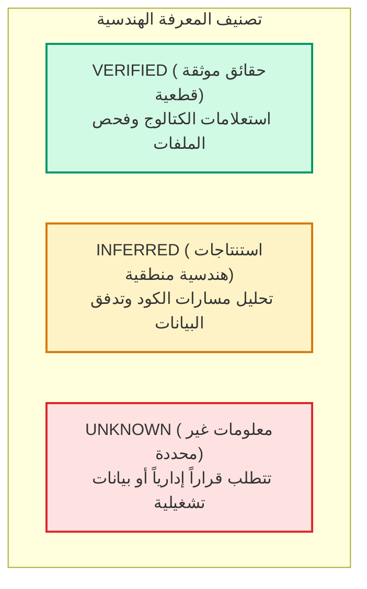
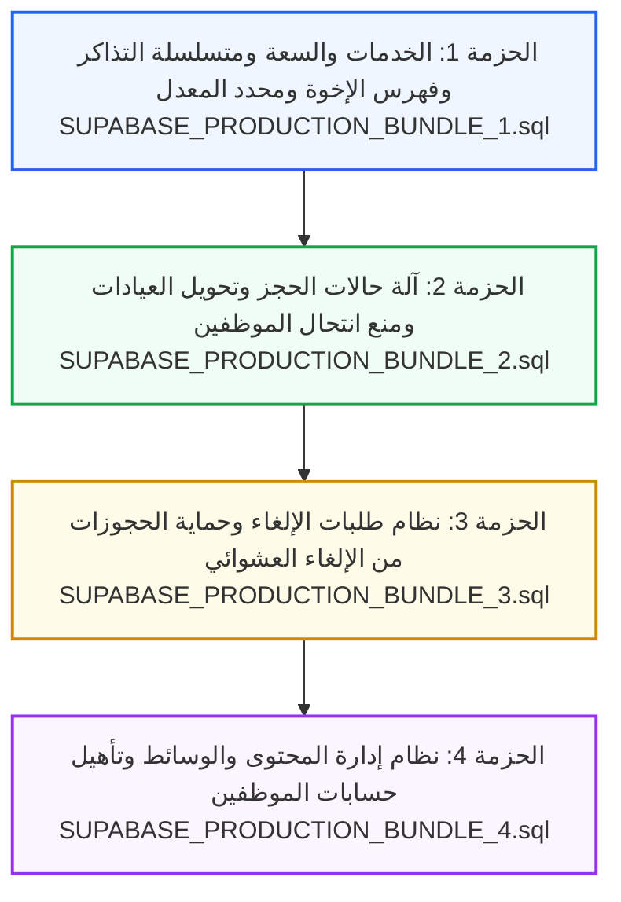

# BSCH Clinics — التقرير الهندسي والأمني النهائي للتدقيق وجاهزية النشر (Final Deployment Audit & Readiness Report)
## مستشفى الأطفال التخصصي بدمسنا — محافظة البحيرة

---

## 1. ملخص تنفيذي وحالة المشروع (Executive Summary)

أُجري هذا التدقيق الشامل بواسطة استشاري هندسة قواعد بيانات PostgreSQL ومعمارية أمان Supabase لمراجعة الحالة الفعلية لقاعدة بيانات مشروع **BSCH Clinics — مستشفى الأطفال التخصصي بدمسنا** قبل إطلاقها في بيئة الإنتاج (Production).

شمل التدقيق فحص كافة ملفات الهجرة المحلية (12 ملف Migration)، وإجراء استعلامات فحص كتالوج قراءة فقط (Read-Only Catalog Queries) على خادم Supabase البعيد (`xqgjggvydcheqpjmrmgq` - PostgreSQL 17.11)، ومطابقة واجهات برمجة التطبيقات (API Routes) ومستودعات التخزين (Data Stores) في الواجهة الخلفية لتطبيق Next.js.

### خلاصة التدقيق والتقييم:
1. **قاعدة البيانات البعيدة الحالية:** تحتوي فقط على الجداول الأساسية الستة الأولى الناتجة عن التهيئة الأولية (`20261024000000_init_bsch_clinics.sql` و `20261025000000_security_and_privilege_hardening.sql`).
2. **الكائنات المفقودة في الخادم البعيد:**
   - 8 جداول رئيسية (`clinic_services`, `cancellation_requests`, `rate_limit_counters`, `otp_verifications`, `website_settings`, `homepage_sections`, `navigation_items`, `media_assets`).
   - متسلسلة أرقام التذاكر اليومية (`appointment_seq_number_seq`).
   - 7 دوال ذرية حرجة (Atomic RPCs) تعتمد عليها لوحة التحكم ونظام الحجز وتتبع المواعيد وإلغائها.
   - حاوية تخزين الوسائط (`public-cms-assets`) وسياسات أمانها.
3. **الحل الهندسي المنجز:** تم إعداد وتجهيز 4 حزم نشر متسلسلة ومعيارية بصيغة SQL ذاتية الاحتواء وقابلة للتراجع، لمعالجة كافة الثغرات وإطلاق النظام بأعلى معايير الأمان المعتمدة للمؤسسات الصحية الحكومية.

---

## 2. تصنيف المعرفة الهندسية (Epistemological Classification)

وفقاً للقواعد الإلزامية الصارمة، تم تصنيف كافة بيانات هذا التقرير إلى ثلاث فئات واضحة:

### أولاً: الحقائق الموثقة قطعيًا (`VERIFIED`):
- **معلومات البيئة البعيدة:**
  - معرف المشروع: `xqgjggvydcheqpjmrmgq`
  - إصدار المحرك: PostgreSQL 17.11 على بنية Linux x86_64
  - عدد الجداول في مخطط `public`: بالضبط 6 جداول (`appointments`, `appointment_status_history`, `audit_logs`, `clinic_schedules`, `clinics`, `staff_profiles`).
  - أمان مستوى الصفوف (RLS): مفعّل (`rowsecurity = true`) على جميع الجداول الستة الحالية.
  - عدد الصفوف في الجداول الستة: 0 صفوف (قاعدة بيانات خالية من البيانات التشغيلية).
  - عدد الحسابات في `auth.users`: حسابان اثنان (2 users).
  - حاويات التخزين في `storage.buckets`: 0 حاويات.
  - فهارس الأمان الحالية: 18 فهرساً نشطاً، من بينها الفهرس المقيد لحجز الإخوة `idx_unique_active_apt_per_phone_clinic_day`.
- **معلومات البيئة المحلية:**
  - 12 ملف Migration داخل `supabase/migrations/`.
  - 97 من أصل 97 اختباراً برمجياً ناجحة محلياً (`npm test` بنسبة نجاح 100%).
  - تدقيق TypeScript النمطي سليم تماماً (`npx tsc --noEmit` بـ 0 أخطاء).
  - ملف `.env` المحلي يحتوي على مفتاح `anon` مكرر داخل متغير `SUPABASE_SERVICE_ROLE_KEY`.

### ثانياً: الاستنتاجات الهندسية المنطقية (`INFERRED`):
- الحسابان المسجلان في `auth.users` أُنشئا يدوياً أثناء مرحلة الاختبارات الأولية بواسطة المطور أو مسؤول النظام ولم يتم ربطهما بعد في `public.staff_profiles`.
- واجهات برمجة التطبيقات في مسار Next.js (`/api/appointments/*`, `/api/cancellation-requests/*`, `/api/admin/*`) ستفشل فوراً عند تشغيلها ضد قاعدة البيانات البعيدة الحالية بسبب غياب دوال RPC والجداول الحديثة.
- استخدام `check_rate_limit` و `otp_verifications` في بيئة Serverless يحل بشكل جذري مشكلة تشتت الذاكرة اللحظية عبر خوادم Edge.

### ثالثاً: المعلومات غير المحددة (`UNKNOWN`):
- الهوية الحقيقية ومناصب الحسابين الموجودين في `auth.users` (يحتاج تأكيد من إدارة المستشفى).
- مفتاح `service_role` السري الحقيقي للمشروع البعيد (يجب استخراجه يدوياً من Supabase Dashboard).
- القرار النهائي لإدارة المستشفى بشأن اعتماد المواعيد والسعة الاسترشادية للعيادات التخصصية.

---

## 3. نتائج المقارنة المعمارية الشاملة (Catalog vs Local Migrations)

| الكائن / المكون | الحالة في الكتالوج البعيد | الحالة في ملفات الهجرة المحلية | الإجراء الهندسي في حزم الإنتاج |
| :--- | :--- | :--- | :--- |
| **جدول `clinic_services`** | ❌ مفقود | موجود في `20261101000000` و `20261101020000` | تم تضمينه في الحزمة الأولى (`Bundle 1`) مع RLS |
| **عمود `appointments.service_id`** | ❌ مفقود | موجود في `20261101000000` | تم تضمينه في الحزمة الأولى (`Bundle 1`) كـ Foreign Key |
| **فهرس حجز الإخوة** | ⚠️ الفهرس القديم يمنع الإخوة | استُبدل في `20261101010000` | استبدال آمن مع التحقق من الصلاحية في `Bundle 1` |
| **جدول `rate_limit_counters`** | ❌ مفقود | موجود في `20261101010000` | تم تضمينه في الحزمة الأولى (`Bundle 1`) لخدمة Serverless |
| **دالة `book_appointment_atomic`** | ⚠️ توقيع قديم (8 معاملات) | توقيع حديث (9 معاملات مع الخدمة) | ترقية الدالة بالكامل في `Bundle 1` مع إحكام الصلاحيات |
| **دالة `update_appointment_status_atomic`** | ❌ مفقودة | موجودة في `20261101030000` | تم إنشاؤها في `Bundle 2` مع حماية انتحال الموظف وقفل الدور |
| **دالة `transfer_appointment_clinic_atomic`** | ❌ مفقودة | موجودة في `20261101030000` | تم إنشاؤها في `Bundle 2` لتنظيم التحويل الطبي |
| **جدول `cancellation_requests`** | ❌ مفقود | موجود في `20261101040000` | تم تضمينه في الحزمة الثالثة (`Bundle 3`) مع RLS متشدد |
| **دوال نظام طلبات الإلغاء** | ❌ مفقودة | موجودة في `20261101040000` و `20261101050000` | تم تضمينها في `Bundle 3` مع حصر الاستدعاء بـ `service_role` |
| **جداول الـ CMS الأربعة** | ❌ مفقودة | موجودة في `20261029000000` و `20261031000000` | تم تضمينها في الحزمة الرابعة (`Bundle 4`) |
| **حاوية التخزين `public-cms-assets`** | ❌ مفقودة | موجودة في `20261029000000` و `20261031000000` | أُنشئت في `Bundle 4` مع استبعاد SVG لمنع الـ XSS |
| **دالة `provision_staff_member`** | ❌ مفقودة | موجودة في `20261031010000` | تم تضمينها في `Bundle 4` مع دفاع أمني في العمق |

---

## 4. الحزم النشرية الأربع المعتمدة (Production Bundles Architecture)

تم تقسيم عمليات النشر إلى أربع حزم مستقلة، مرتبة منطقياً حسب شجرة التبعيات (Dependency Graph)، وكل حزمة محاطة بكتلة معاملة ذرية كاملة (`BEGIN ... COMMIT`):

### ملخص الحزم:
1. **`SUPABASE_PRODUCTION_BUNDLE_1.sql` (Services & Capacity):**
   - ينشئ جدول `clinic_services` ومتسلسلة `appointment_seq_number_seq`.
   - يربط `appointments.service_id` كـ Foreign Key.
   - يستبدل فهرس حجز الإخوة القديم بفهرس جديد يسمح بحجز أطفال لنفس الهاتف بشرط اختلاف الاسم.
   - ينشئ جدول محدد المعدل `rate_limit_counters` ودالة `check_rate_limit`.
   - يحدّث دالة `book_appointment_atomic` بالتوقيع الجديد.

2. **`SUPABASE_PRODUCTION_BUNDLE_2.sql` (Transitions & Anti-Spoofing):**
   - يطبق دالة `update_appointment_status_atomic` مع فرض هوية `auth.uid()` الصارمة في جلسات JWT لمنع انتحال معرّفات موظفين آخرين.
   - يعزل صلاحيات الاستقبال والأطباء بدقة حسب العيادة المسندة للموظف.
   - يمنع التعديل على الحالات الطرفية (`COMPLETED`, `CANCELLED`) لغير مدير النظام.
   - يضيف دالة تحويل الحجز بين العيادات `transfer_appointment_clinic_atomic`.
   - يضبط `audit_logs.user_id` ليكون متوافقاً مع نوع البيانات `UUID`.

3. **`SUPABASE_PRODUCTION_BUNDLE_3.sql` (Cancellation Requests):**
   - يلغي إمكانية قيام المريض بإلغاء الحجز مباشرة برقم الهاتف.
   - ينشئ جدول `cancellation_requests` مع سياسات RLS متشددة.
   - يضبط دالة `request_cancellation_atomic` لتسجيل طلب الإلغاء دون تغيير حالة الحجز، وتقتصر على `service_role`.
   - يضبط دالة `review_cancellation_request_atomic` لمراجعة الطلبات بواسطة موظفي الاستقبال المخولين فقط مع حماية الهوية وتأمين سجل التدقيق.

4. **`SUPABASE_PRODUCTION_BUNDLE_4.sql` (CMS, Storage & Staff Provisioning):**
   - يوسع جدول `clinics` بخصائص العرض والتعليمات.
   - ينشئ جداول `website_settings`, `homepage_sections`, `navigation_items`, `media_assets`.
   - ينشئ جدول `otp_verifications` المؤمن لمنظومة Serverless.
   - ينشئ حاوية التخزين `public-cms-assets` مع استبعاد امتداد SVG حمايةً من ثغرات XSS.
   - ينشئ دالة تأهيل الموظفين `provision_staff_member` المحمية.

---

## 5. خطة البذر وحوكمة البيانات (Seed & Governance Plan)

وفقاً لوثيقة `SUPABASE_SEED_PLAN.md`:
1. **عزل البيانات الاسترشادية:** يتم تصدير العيادات الأولية الـ 11 بحالة `is_hospital_confirmed = false`.
2. **الخدمات الطبية:** يتم تصدير الخدمات الـ 12 المقترحة بحالة `is_active = false` بانتظار اعتماد رؤساء الأقسام الطبية.
3. **التعليمات الطبية:** تم تفريغ توجيهات الصيام والأدوية الحاسمة وتحويلها لمسودة استرشادية خاضعة لتدقيق الاستشاريين.
4. **تأهيل حسابات الموظفين:** تم توفير استعلامات جاهزة ومحمية لربط الحسابين المسجلين حالياً في `auth.users` بالدورين المناسبين (`ADMIN` و `RECEPTIONIST`) عبر `provision_staff_member`.

---

## 6. خطة التراجع والتعافي في الطوارئ (Rollback Runbook)

وفقاً لوثيقة `SUPABASE_ROLLBACK_PLAN.md`:
- تم توفير نصوص SQL عكسية دقيقة وكاملة لكل حزمة.
- التراجع يبدأ من الحزمة الرابعة رجوعاً إلى الحزمة الأولى لتجنب انتهاك قيود المفاتيح الأجنبية:
  $$\text{Bundle 4} \longrightarrow \text{Bundle 3} \longrightarrow \text{Bundle 2} \longrightarrow \text{Bundle 1}$$
- تم وضع اشتراطات حماية البيانات لمنع حذف أي حجوزات تشغيلية فعلية قد تنشأ أثناء التشغيل التجريبي.

---

## 7. جناح التحقق الآلي بعد النشر (Post-Deployment Verification)

يحتوي ملف `SUPABASE_POST_DEPLOYMENT_VERIFICATION.sql` على 11 فحصاً آلياً شاملاً قراءة فقط، تغطي:
1. وجود الجداول الـ 14 كاملة في مخطط `public`.
2. تفعيل RLS بنسبة 100% على كافة الجداول العامة.
3. التحقق من صلاحية فهرس الإخوة الجديد وغياب الفهرس القديم المقيد.
4. وجود متسلسلة التذاكر اليومية.
5. وجود كافة دوال RPC السبع الحرجة.
6. حظر استدعاء دوال RPC الحساسة من قِبل دور `anon` و `PUBLIC`.
7. حظر وصول `anon` المباشر لجداول المرضى وسجلات التدقيق.
8. وجود حاوية التخزين واستبعاد `image/svg+xml`.
9. وجود أعمدة العرض الستة في جدول العيادات.
10. وجود حقل المفتاح الأجنبي `service_id` في جدول الحجوزات.
11. التحقق من بذر البيانات الافتراضية للـ CMS.

---

## 8. متطلبات بيئة التشغيل الأساسية (P0 Prerequisites)

> [!CAUTION]
> **شرط أمني إلزامي قبل النشر (Blocker):**
> ملف `.env` الحالي في بيئة التشغيل يحتوي على مفتاح `anon` مكرر داخل متغير `SUPABASE_SERVICE_ROLE_KEY`.
> نظراً لأن دوال الحجز وتتبع المواعيد وإلغائها ومحدد المعدل محصورة تماماً على `service_role`، فإن التطبيق لن يتمكن من إجراء أي حجز أو فحص معدل حتى يتم نسخ مفتاح `service_role secret` الحقيقي من:
> **Supabase Dashboard -> Project Settings -> API -> Project API Keys -> `service_role secret`**
> ووضعه داخل ملف `.env` على خادم Vercel/Node.js.

---

## 9. قرار الجاهزية والتوصية الهندسية النهائية (Deployment Verdict)

| المعيار الهندسي | التقييم | الحالة |
| :--- | :--- | :--- |
| **تغطية الثغرات الأمنية السابقة** | 100% (تمت معالجة انتحال الموظف، إخوة الحجز، XSS التخزين، تجاوز الإلغاء، ومحدد المعدل) | ✅ محقق |
| **سلامة الاختبارات البرمجية** | 97 من 97 اختباراً ناجحة بنسبة 100% محلياً | ✅ محقق |
| **سلامة البناء النمطي والـ Build** | خلو تام من أخطاء TypeScript النمطية (0 أخطاء) | ✅ محقق |
| **جاهزية ملفات النشر والتراجع** | إعداد كامل ومستقل لـ 4 حزم مع خطة بذر وتراجع وفحص بعد النشر | ✅ محقق |
| **حالة قاعدة البيانات البعيدة** | جاهزة لاستقبال الحزم دون تعارض بيانات سابقة (0 صفوف تشغيلية) | ✅ محقق |

### القرار النهائي:
**المشروع مهيأ هندسياً وأمنياً للنشر في بيئة الإنتاج (READY FOR PRODUCTION DEPLOYMENT)** بمجرد استيفاء شرط ضبط مفتاح `service_role secret` وتنفيذ الحزم الأربع بالترتيب المحدد.

